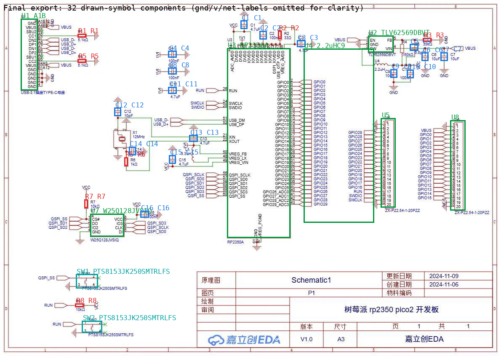
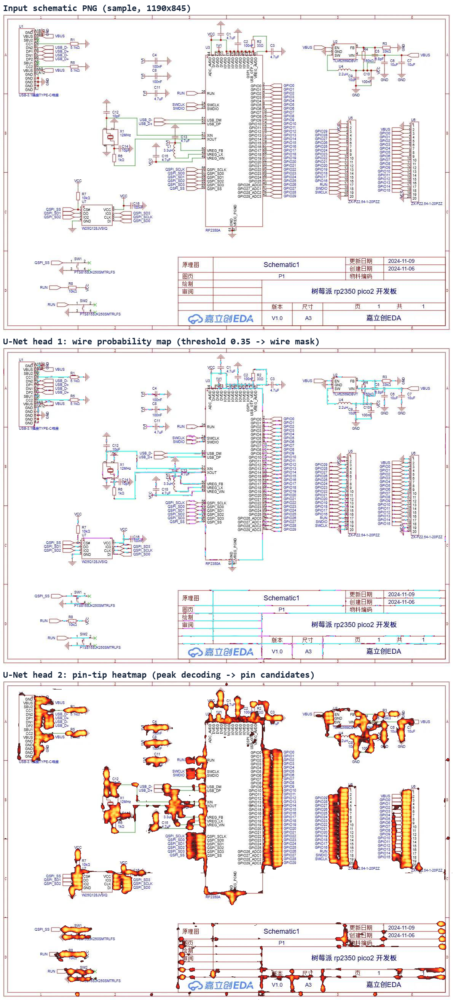
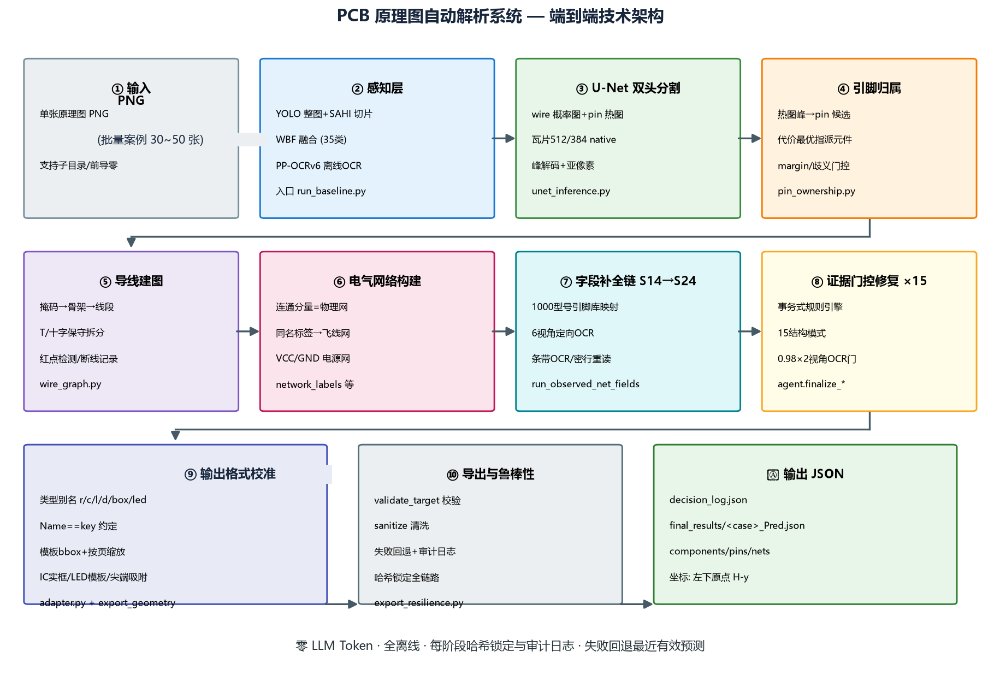

# PCB 原理图自动解析

[English](README_en.md) | 简体中文

**PCB Schematic Parser** — 把原理图 PNG 转换为可评测、可复用的结构化电路描述:元件、引脚、网络成员与导线几何。


端到端全离线推理,不依赖任何大模型 API;662 项单元测试覆盖核心逻辑。

## 目录

- [任务定义](#任务定义)
- [效果示例](#效果示例)
- [方案](#方案)
- [指标](#指标)
- [环境要求](#环境要求)
- [快速开始](#快速开始)
- [输出说明](#输出说明)
- [模型与权重](#模型与权重)
- [目录结构](#目录结构)
- [相关项目](#相关项目)
- [致谢](#致谢)
- [许可证](#许可证)

## 任务定义

**输入**:一个目录下的原理图 PNG(可含子目录,保留文件名前导零)。
**输出**:每个 PNG 对应一份 JSON,包含元件(类别 / 位号 / Name / value / bbox)、嵌套引脚、电气网络(hyperGraph + 导线折线)。

输出 JSON 结构示意(节选,坐标为示意值):

```json
{
  "components": {
    "R1":  { "type": "r",   "Name": "R1",      "value": "10k",   "bbox": [1120, 458, 1140, 478] },
    "C3":  { "type": "c",   "Name": "C3",      "value": "100nF", "bbox": [1318, 386, 1334, 406] },
    "U1":  { "type": "box", "Name": "RP2350A", "value": null,    "bbox": [921, 118, 1081, 588] },
    "G1":  { "type": "gnd", "value": "GND" }
  },
  "pins": {
    "R1": {
      "pin_1": { "pinname": "", "point": { "x": 1100, "y": 468 } },
      "pin_2": { "pinname": "", "point": { "x": 1160, "y": 468 } }
    }
  },
  "nets": {
    "n1": {
      "hyperGraph": "(R1.1,C3.1)",
      "edges": { "e1": [ { "x": 1100, "y": 468 }, { "x": 1140, "y": 468 }, { "x": 1318, "y": 468 } ] }
    }
  }
}
```

## 效果示例

样例为公开的树莓派 RP2350 开发板原理图(嘉立创 EDA)。

| 输入与检测 | U-Net 双头分割 | 最终输出 |
| --- | --- | --- |
|  |  |  |

## 方案

<p align="center">
  
</p>

**流水线**:YOLO 元件检测(整图 + SAHI 切片,WBF 融合,35 类)→ RapidOCR 文字识别 → 双头 U-Net(导线概率图 + 引脚尖端热图)→ 引脚归属 / 公共引脚库 / 字段补全 → 导线图与电源 / 逻辑网络 → 目标 JSON。

关键设计:

- **证据门控的字段补全**——value 与编号只在有图像证据时写入,不能确认时保持 null,不按符号类别猜默认值
- **电源 / 地出口修复**——已检测但无位号的电源不再丢弃,供电类别统一转换
- **IC / LED 精修**——实框定位、文字与框联合修复、Name 候选优先级
- **审计与稳健性**——每例独立日志 + decision_log,部分失败不中断,哈希锁定全链路,失败回退最近有效预测

## 指标

本地验证口径(13 页样例回放与自建验证集,口径说明见 `verified_application/docs/`):

| 阶段 | 指标 | 数值 |
| --- | --- | --- |
| 元件检测 | 整图 F1 | 0.8008 |
| 元件检测 | 切片 F1 | 0.8132 |
| 导线掩膜 v2 | 平均导线 F1 | 0.6064 |
| 连接关系 v2 | 平均 F1 | 0.5926 |

## 环境要求

| 项目 | 要求 |
| --- | --- |
| Python | 3.12(参考;`requirements.txt` 不含 torch,需按 PyTorch 官方渠道单独安装) |
| GPU | CUDA 12.1 + torch 2.5.1;显存 ≥ 24 GiB 时最多 3 例并行,小显存自动串行 |
| GPU 架构 | 实测环境为 sm_80;RTX 50 系(sm_120)等新架构请用 `--device cpu` |
| 磁盘 | 仓库约 140 MB(含全部权重) |

## 快速开始

**Docker**:

```bash
docker build -t pcb-parser:test ./verified_application
docker run --rm --gpus all \
  -v <输入绝对路径>:/input:ro -v <输出绝对路径>:/output:rw \
  pcb-parser:test -input /input -output /output
```

**本地 Python**(不装 Docker 时):

```bash
# 1. 安装 PyTorch(按官方渠道选择 CUDA 版本)
pip install torch==2.5.1 --index-url https://download.pytorch.org/whl/cu121

# 2. 安装其余依赖(Python ≥ 3.11)
cd verified_application
pip install -r requirements.txt

# 3. 运行
python agent.py -input <输入目录> -output <输出目录> --device cpu
```

**试跑样例**:仓库自带 `examples/rp2350_page1.png`(公开的 RP2350 开发板原理图第一页,嘉立创 EDA),clone 后即可零配置端到端试跑:

```bash
python agent.py -input examples -output <输出目录> --device cpu
```

GPU 自动探测(先执行真实 CUDA 矩阵运算验证),驱动或架构不兼容时记录错误并回退 CPU。完整参数与运行细节见 [verified_application/README.md](verified_application/README.md)。

## 输出说明

| 路径 | 内容 |
| --- | --- |
| `/output/final_results/<case_id>_Pred.json` | 默认交付:嵌套 pins、hyperGraph、edges |
| `/output/project_results/<case_id>_Pred.json` | 原始模型 / OCR 结果,便于排查 |
| `/output/decision_log.json` | 每例状态与失败原因(部分失败不中断,输出空 JSON 并继续) |
| `/output/logs/` | 逐例证据:OCR 文本、LED / IC 几何前后对比、电源导出证据、运行时环境 |

导出语义、阶段说明与逐文件清单见 [EXPORT_SEMANTICS.md](verified_application/EXPORT_SEMANTICS.md)、[OPTIMIZATION.md](verified_application/OPTIMIZATION.md) 与 `package_manifest.json`。

## 模型与权重

| 模块 | 模型 | 权重文件 | 来源 |
| --- | --- | --- | --- |
| 元件检测 | YOLOv8n 架构,35 类 | `detector_dataset300_v3_nano.pt` | 基线权重取自公开项目,在本项目数据上继续训练 |
| 导线 / 引脚分割 | 双头 U-Net | `unet_wire_pin_v1.pt` | 本项目自行训练 |
| 文字识别 | RapidOCR(PP-OCRv6) | `assets/ocr/PP-OCRv6_rec_small.onnx` | PaddleOCR,Apache-2.0 |

基线检测器权重的完整出处(仓库、哈希、许可)见 [weights/baseline_provenance.json](verified_application/weights/baseline_provenance.json)。

## 目录结构

```
pcb-schematic-parser/
├── README.md / README_en.md      # 本文档(中 / 英)
├── LICENSE
├── assets/                       # 架构图与效果示例
├── examples/                     # 可直接试跑的样例输入
│   └── rp2350_page1.png
└── verified_application/         # 完整推理包
    ├── agent.py                  # 推理入口
    ├── adapter.py / src/         # 目标格式转换与核心解析模块
    ├── configs/                  # 各阶段配置
    ├── weights/                  # 检测与分割权重
    ├── assets/ocr/               # OCR 模型
    ├── data/                     # 引脚库 / 元件库
    ├── tests/                    # 662 项单元测试
    ├── docs/                     # 各阶段技术说明
    ├── Dockerfile                # 参考 Dockerfile
    └── package_manifest.json     # 逐文件哈希清单
```

## 相关项目

同类方向的开源工作,供参考对照:

- [Image2schematic](https://github.com/s39674/Image2schematic) — 用计算机视觉与神经网络从图像提取原理图
- [CircuitSchematicImageInterpreter](https://github.com/C-R-Kelly/CircuitSchematicImageInterpreter) — 电路原理图图像的自动数字解析
- [kicad-tools](https://github.com/rjwalters/kicad-tools) — KiCad 原理图文件的解析与分析工具集
- [OmniSch](https://arxiv.org/abs/2604.00270) — 多模态 PCB 原理图基准(1,854 张真实原理图)

## 致谢

- [Ultralytics YOLOv8](https://github.com/ultralytics/ultralytics) — 元件检测器训练框架
- [PaddleOCR](https://github.com/PaddlePaddle/PaddleOCR) / [RapidOCR](https://github.com/RapidAI/RapidOCR) — 文字识别(PP-OCRv6 识别模型)
- [UNet++](https://arxiv.org/abs/1807.10165) — 嵌套稠密跳跃连接与深监督的分割结构参考
- [HR-DONK/circuit-recognition](https://github.com/HR-DONK/circuit-recognition) — 检测器基线权重出处

## 许可证

本项目代码以 [MIT](LICENSE) 许可发布。第三方组件许可:检测器训练框架 Ultralytics 为 AGPL-3.0(独立于本仓库许可);OCR 模型源自 PaddleOCR(Apache-2.0);基线检测器权重出处仓库为 MIT,详见 `weights/baseline_provenance.json`。
