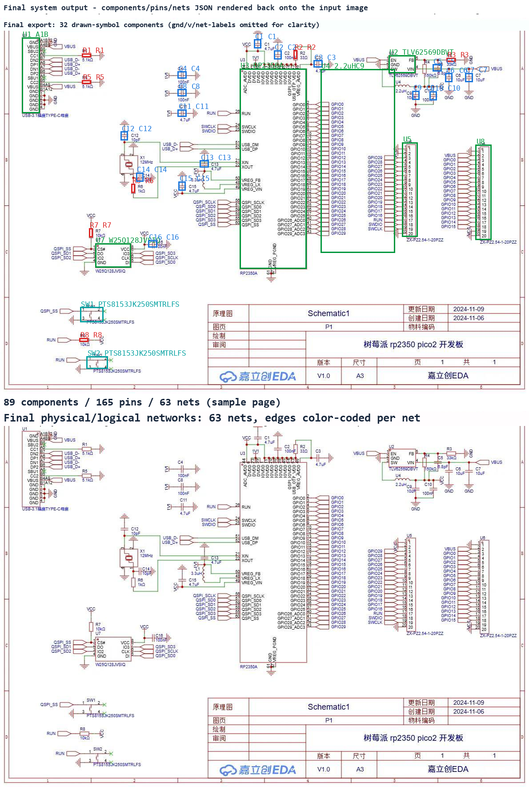

# PCB 原理图自动解析

**PCB Schematic Parser** — 把原理图 PNG 转换为可评测、可复用的结构化电路描述:元件、引脚、网络成员与导线几何。


端到端全离线推理,不依赖任何大模型 API。

<p align="center">
  
</p>

## 特性

- **端到端**:单张原理图 PNG → 元件 / 引脚 / 网络 / 导线几何 JSON
- **双路检测**:YOLO 整图 + SAHI 切片,WBF 融合(35 类)
- **双头 U-Net**:导线概率图 + 引脚尖端热图,峰解码 + 亚像素细化
- **证据门控的字段补全**:value 与编号只在有图像证据时写入,不能确认时保持 null,不按符号类别猜默认值
- **电源 / 地出口修复**:已检测但无位号的电源不再丢弃,供电类别统一转换
- **IC / LED 精修**:实框定位、文字与框联合修复、Name 候选优先级
- **审计与稳健性**:每例独立日志 + decision_log,部分失败不中断,哈希锁定全链路
- **运行时自适应**:GPU 自动探测(真实 CUDA 矩阵运算验证)并回退 CPU,`--workers 1/2/3` 可调并行

## 效果示例

样例为公开的树莓派 RP2350 开发板原理图(嘉立创 EDA)。

| 输入与检测 | U-Net 双头分割 | 最终输出 |
| --- | --- | --- |
|  |  |  |

## 指标

以下为本地验证口径(13 页样例回放与自建验证集,口径说明见 `verified_application/docs/`):

| 阶段 | 指标 | 数值 |
| --- | --- | --- |
| 元件检测 | 整图 F1 | 0.8008 |
| 元件检测 | 切片 F1 | 0.8132 |
| 导线掩膜 v2 | 平均导线 F1 | 0.6064 |
| 连接关系 v2 | 平均 F1 | 0.5926 |

## 快速开始

```bash
docker build -t pcb-parser:test ./verified_application
docker run --rm --gpus all \
  -v <输入绝对路径>:/input:ro -v <输出绝对路径>:/output:rw \
  pcb-parser:test -input /input -output /output
```

CPU 运行去掉 `--gpus all` 并加 `-e PCB_DEVICE=cpu`;已装同版本依赖时也可直接 `python agent.py -input <目录> -output <目录>`。完整说明见 [verified_application/README.md](verified_application/README.md)([English](verified_application/README_en.md))。

## 目录导览

| 路径 | 内容 |
| --- | --- |
| [`verified_application/`](verified_application/) | 完整推理包:权重、OCR 资产、配置、脚本、测试、逐文件哈希清单与双语 README |
| [`verified_application/docs/`](verified_application/docs/) | 各阶段技术说明(导线建图、引脚修复、电源出口、几何校准等) |
| [`assets/`](assets/) | 架构图与效果示例 |

## 相关项目

同类方向的开源工作,供参考对照:

- [Image2schematic](https://github.com/s39674/Image2schematic) — 用计算机视觉与神经网络从图像提取原理图
- [CircuitSchematicImageInterpreter](https://github.com/C-R-Kelly/CircuitSchematicImageInterpreter) — 电路原理图图像的自动数字解析
- [kicad-tools](https://github.com/rjwalters/kicad-tools) — KiCad 原理图文件的解析与分析工具集
- [OmniSch](https://arxiv.org/html/2604.00270v3) — 多模态 PCB 原理图基准(1,854 张真实原理图)

## 致谢

- [Ultralytics YOLOv8](https://github.com/ultralytics/ultralytics) — 元件检测器训练框架
- [PaddleOCR](https://github.com/PaddlePaddle/PaddleOCR) / [RapidOCR](https://github.com/RapidAI/RapidOCR) — 文字识别(PP-OCRv6 识别模型)
- [UNet++](https://arxiv.org/abs/1807.10165) — 嵌套稠密跳跃连接与深监督的分割结构参考
