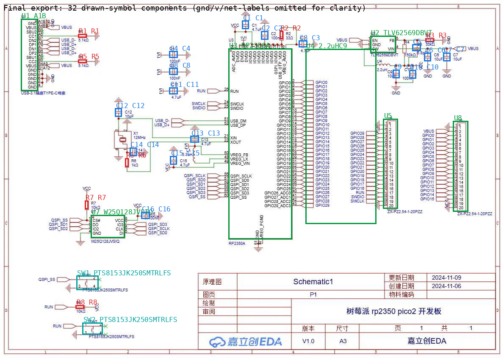
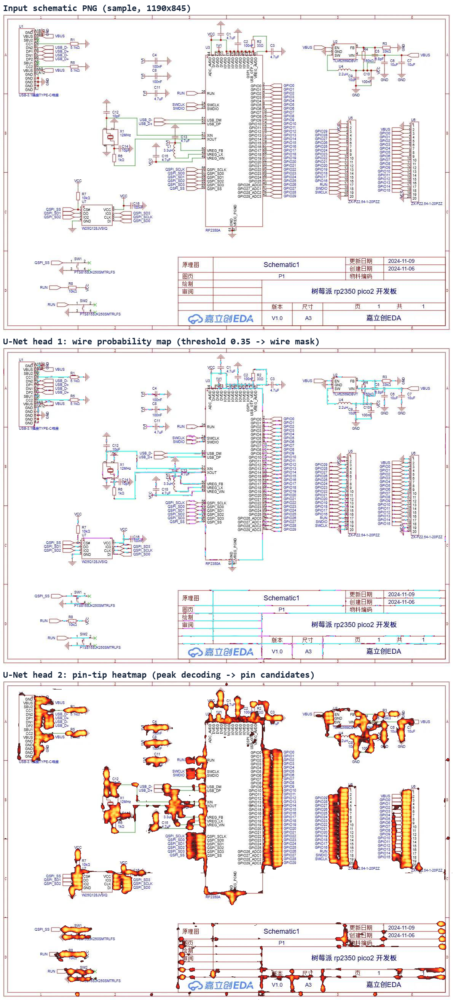
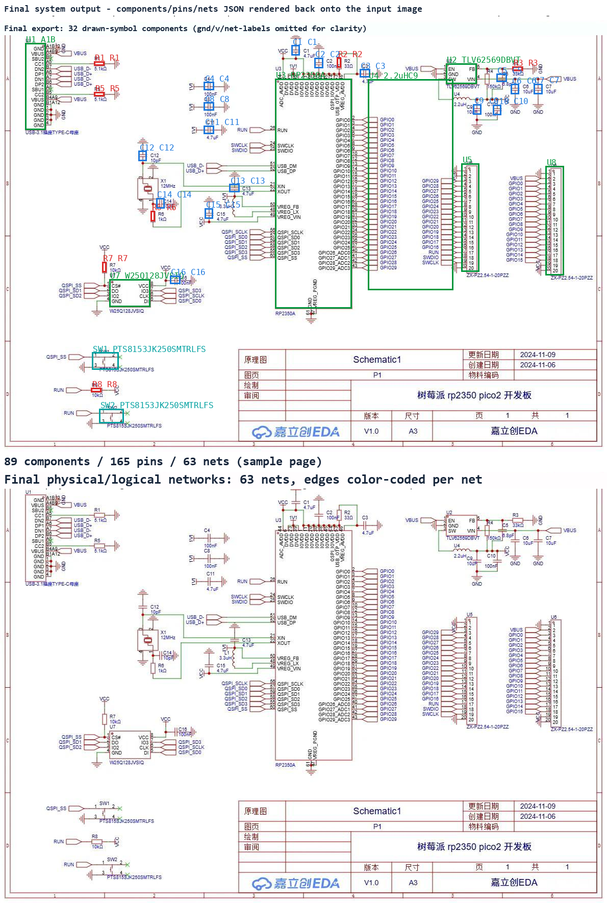
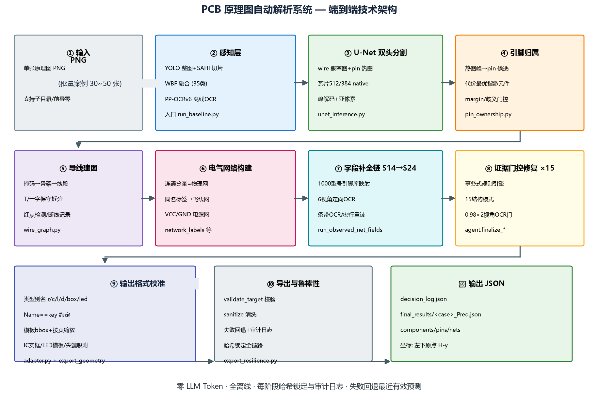

# PCB Schematic Parser

English | [简体中文](README.md)

Converts schematic PNG images into evaluable, reusable structured circuit descriptions: components, pins, nets, and wire geometry.


Fully offline end-to-end inference — no LLM/VLM APIs. 662 unit tests cover the core logic.

## Table of contents

- [Task](#task)
- [Results](#results)
- [Approach](#approach)
- [Metrics](#metrics)
- [Requirements](#requirements)
- [Quick start](#quick-start)
- [Output layout](#output-layout)
- [Models and weights](#models-and-weights)
- [Repository layout](#repository-layout)
- [Related projects](#related-projects)
- [Acknowledgments](#acknowledgments)
- [License](#license)

## Task

**Input**: a directory of schematic PNGs (subdirectories allowed; leading zeros in filenames are preserved).
**Output**: one JSON per PNG with components (type / key / Name / value / bbox), nested pins, and electrical networks (hyperGraph + wire polylines).

Illustrative JSON structure (excerpt; coordinates are example values):

```json
{
  "components": {
    "R1":  { "type": "r",   "Name": "R1",      "value": "10k",   "bbox": [1120, 458, 1140, 478] },
    "C3":  { "type": "c",   "Name": "C3",      "value": "100nF", "bbox": [1318, 386, 1334, 406] },
    "U1":  { "type": "box", "Name": "RP2350A", "value": null,    "bbox": [921, 118, 1081, 588] },
    "G1":  { "type": "gnd", "value": "GND" }
  },
  "pins": {
    "R1": {
      "pin_1": { "pinname": "", "point": { "x": 1100, "y": 468 } },
      "pin_2": { "pinname": "", "point": { "x": 1160, "y": 468 } }
    }
  },
  "nets": {
    "n1": {
      "hyperGraph": "(R1.1,C3.1)",
      "edges": { "e1": [ { "x": 1100, "y": 468 }, { "x": 1140, "y": 468 }, { "x": 1318, "y": 468 } ] }
    }
  }
}
```

## Results

The sample is the public Raspberry Pi RP2350 dev-board schematic (LCEDA / EasyEDA).

| Input & detection | Dual-head U-Net | Final output |
| --- | --- | --- |
|  |  |  |

## Approach

<p align="center">
  
</p>

**Pipeline**: YOLO component detection (whole image + SAHI tiling, WBF fusion, 35 classes) → RapidOCR text recognition → dual-head U-Net (wire probability map + pin-tip heatmap) → pin attribution / common-pin library / field completion → wire graph and power/logic networks → target JSON.

Key design points:

- **Evidence-gated field completion** — value and designators are written only with image evidence; unverifiable fields stay null instead of being guessed from symbol classes
- **Power/ground export repair** — detected power symbols without designators are no longer dropped; supply categories are converted uniformly
- **IC/LED refinement** — real-frame localization, joint text-and-box repair, Name candidate priority
- **Auditability and robustness** — per-case logs plus a decision log; partial failures don't abort the batch; hash locking across the chain; failed cases roll back to the last validated prediction

## Metrics

Local validation scope (13-page sample replay and the project's own validation set; scope notes in `verified_application/docs/`):

| Stage | Metric | Value |
| --- | --- | --- |
| Component detection | Whole-image F1 | 0.8008 |
| Component detection | Tiled F1 | 0.8132 |
| Wire mask v2 | Mean wire F1 | 0.6064 |
| Connectivity v2 | Mean F1 | 0.5926 |

## Requirements

| Item | Requirement |
| --- | --- |
| Python | 3.12 (reference; `requirements.txt` excludes torch — install it via the PyTorch official channel) |
| GPU | CUDA 12.1 + torch 2.5.1; up to 3 cases in parallel with ≥ 24 GiB VRAM, smaller GPUs run serially |
| GPU architecture | Tested on sm_80; newer architectures (e.g. RTX 50 series, sm_120) should use `--device cpu` |
| Disk | ~140 MB repository (all weights included) |

## Quick start

**Docker**:

```bash
docker build -t pcb-parser:test ./verified_application
docker run --rm --gpus all \
  -v <absolute-input-path>:/input:ro -v <absolute-output-path>:/output:rw \
  pcb-parser:test -input /input -output /output
```

**Local Python**:

```bash
# 1. Install PyTorch (pick the CUDA build via the official channel)
pip install torch==2.5.1 --index-url https://download.pytorch.org/whl/cu121

# 2. Install the remaining dependencies
cd verified_application
pip install -r requirements.txt

# 3. Run
python agent.py -input <input-dir> -output <output-dir> --device cpu
```

GPU is auto-detected (verified with a real CUDA matmul); on driver or architecture mismatch the exact error is logged and the run falls back to CPU. Full parameters and runtime details: [verified_application/README_en.md](verified_application/README_en.md).

## Output layout

| Path | Content |
| --- | --- |
| `/output/final_results/<case_id>_Pred.json` | Default deliverable: nested `pins`, `hyperGraph`, `edges` |
| `/output/project_results/<case_id>_Pred.json` | Raw model/OCR results for debugging |
| `/output/decision_log.json` | Per-case status and failure reasons (partial failures yield empty JSON and continue) |
| `/output/logs/` | Per-case evidence: OCR texts, LED/IC geometry before/after, power export evidence, runtime environment |

Export semantics, stage notes, and the per-file manifest: [EXPORT_SEMANTICS.md](verified_application/EXPORT_SEMANTICS.md), [OPTIMIZATION.md](verified_application/OPTIMIZATION.md), and `package_manifest.json`.

## Models and weights

| Module | Model | Weights | Origin |
| --- | --- | --- | --- |
| Component detection | YOLOv8n architecture, 35 classes | `detector_dataset300_v3_nano.pt` | Baseline weights from a public project, further trained on this project's data |
| Wire/pin segmentation | Dual-head U-Net | `unet_wire_pin_v1.pt` | Trained in this project |
| Text recognition | RapidOCR (PP-OCRv6) | `assets/ocr/PP-OCRv6_rec_small.onnx` | PaddleOCR, Apache-2.0 |

Full provenance of the baseline detector weights (repository, hash, license): [weights/baseline_provenance.json](verified_application/weights/baseline_provenance.json).

## Repository layout

```
pcb-schematic-parser/
├── README.md / README_en.md      # This documentation (en / zh)
├── LICENSE
├── assets/                       # Architecture diagram and result figures
└── verified_application/         # Complete inference package
    ├── agent.py                  # Inference entrypoint
    ├── adapter.py / src/         # Target-format conversion and core parsing modules
    ├── configs/                  # Per-stage configuration
    ├── weights/                  # Detection and segmentation weights
    ├── assets/ocr/               # OCR models
    ├── data/                     # Pin library / component library
    ├── tests/                    # 662 unit tests
    ├── docs/                     # Per-stage technical notes
    ├── Dockerfile                # Reference Dockerfile
    └── package_manifest.json     # Per-file hash manifest
```

## Related projects

Open-source work in the same direction, for reference:

- [Image2schematic](https://github.com/s39674/Image2schematic) — extracting schematics from images with CV and neural networks
- [CircuitSchematicImageInterpreter](https://github.com/C-R-Kelly/CircuitSchematicImageInterpreter) — automatic digital interpretation of circuit schematic images
- [kicad-tools](https://github.com/rjwalters/kicad-tools) — parsing and analysis tooling for KiCad schematic files
- [OmniSch](https://arxiv.org/abs/2604.00270) — a multimodal PCB schematic benchmark (1,854 real schematics)

## Acknowledgments

- [Ultralytics YOLOv8](https://github.com/ultralytics/ultralytics) — detector training framework
- [PaddleOCR](https://github.com/PaddlePaddle/PaddleOCR) / [RapidOCR](https://github.com/RapidAI/RapidOCR) — text recognition (PP-OCRv6)
- [UNet++](https://arxiv.org/abs/1807.10165) — nested dense skip connections and deep supervision reference
- [HR-DONK/circuit-recognition](https://github.com/HR-DONK/circuit-recognition) — origin of the baseline detector weights

## License

This project's code is released under the [MIT](LICENSE) license. Third-party components: the Ultralytics framework used to train detector weights is AGPL-3.0 (separate from this repository's license); OCR models derive from PaddleOCR (Apache-2.0); the baseline detector weights' source repository is MIT — see `weights/baseline_provenance.json`.
