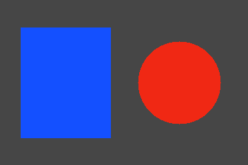

# 第02周讲义｜图像读写、颜色与基本运算

[本周计划](README.md) · [完整代码](demo.py) · [练习](练习.md)

学习方法：先读直觉和小例子，再看代码；不懂时停下来运行、打印中间值。理解的标准是能预测变化并解释结果，而不是一次读完。


## 1. 读写是算法的入口和出口

图片文件像一本压缩过的数字账本，读取后才得到能参与计算的数组。最短写法是 `image=cv2.imread('photo.jpg')`，但文件找不到或解码失败时可能返回 None；此时继续调用 `cvtColor` 会出现难懂的底层报错。正确顺序是先验证读取成功，再处理。

本课为了支持中文路径，使用 `np.fromfile` 读取文件字节，再由 `cv2.imdecode` 解码；保存时反过来，先 `imencode`，再写字节。它们没有改变算法，只是把“访问文件”和“解读图片”分开。代码明确区分“文件不存在”和“不是有效图片”，排错就容易得多。

## 2. BGR与灰度不是同一回事

OpenCV 常见彩色输入顺序是蓝、绿、红。别把 `(255,0,0)` 当成红色。灰度转换不是随便拿一个通道，也不是简单求平均，常用转换大约为 `0.114B+0.587G+0.299R`。人眼对不同颜色的亮度感觉不同，所以权重不同。

纯蓝约变成29，纯绿约150，纯红约76。两种不同颜色可能得到同样灰度，因此灰度不能恢复原颜色。把灰度重新转为BGR，只是将一个亮度复制到三个通道，不是把颜色找回来。

## 3. 掩膜是一张“通行证”

掩膜是与图像同宽高的单通道图。本课让0表示不选、255表示选中。注意：掩膜通常用 uint8，不应随便用默认的浮点数组。

```python
mask = np.zeros(gray.shape, np.uint8)
cv2.circle(mask, (260,120), 60, 255, -1)
selected = cv2.bitwise_and(image, image, mask=mask)
```

第一句发一张全拒绝的通行证；第二句把圆形区域改成允许通行；第三句在允许区域保留原图，其余置黑。`-1` 表示把圆填满，正数表示线条厚度。这里同一张图和自己做按位与，像素值不会改变；真正完成区域选择的是 mask。

若想让圆外变成灰色而不是黑色，应先准备整张灰度三通道图，再写 `spotlight[mask>0]=image[mask>0]`。条件 `mask>0` 是一张 True/False 表，NumPy只替换为True的位置。

## 4. 图像运算需要考虑数值范围

OpenCV 的 uint8 `cv2.add` 使用饱和加法：250+10截到255。NumPy 的 uint8 数组加法会回绕到4。不存在某个函数永远更好，关键是你想要什么行为。

混合函数 `addWeighted(a,0.6,b,0.4,0)` 计算每个像素的 `0.6a+0.4b+0`。例如对应通道是100和200，结果就是140。最后的0是额外亮度偏移，不是透明度。参与相加的图一般要有匹配的尺寸、通道和数据类型。

## 5. 逐步观察本周演示

`make_scene` 生成蓝色矩形和红色圆，`read_image` 再把落盘文件读回来，确保确实走过读写过程。看 `02_gray.png` 时留意不同颜色变成不同灰度；看 `03_mask.png` 时只应有一个白圆；看 `05_spotlight.png` 时只有红圆保留彩色。结果错误时按“读到了吗→shape对吗→通道对吗→mask对吗”逐层检查。

PNG适合反复保存教学中间结果，因为不会像JPEG那样每次有损压缩。调试阈值时，压缩产生的细微像素变化也可能影响结果。


## 运行后对照这些结果

输出原图、灰度、圆形掩膜、只保留圆形的图片、局部彩色图和混合图；普通加法是4，OpenCV饱和加法是255。

下面图片来自随课程实际运行保存的输出；重新执行程序后图片会更新。

**彩色输入**



**掩膜保留局部颜色**


更多中间结果在本周 `outputs` 文件夹；数值解释见 [metrics.json](outputs/metrics.json)。

## 查官方文档时看什么

先在官方目录找到本周主题，再看参数、返回值、输入数据类型与例子。官方链接用于核对接口；本讲义中的生活比喻、实验安排和示例代码为本课程编写。

- [OpenCV-Python 官方教程总目录](https://docs.opencv.org/4.x/d6/d00/tutorial_py_root.html)
- [OpenCV 图像处理教程目录](https://docs.opencv.org/4.12.0/d2/d96/tutorial_py_table_of_contents_imgproc.html)
