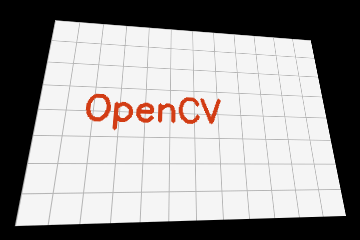
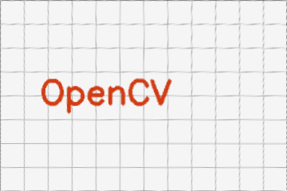

# 第03周讲义｜缩放、旋转与透视变换

[本周计划](README.md) · [完整代码](demo.py) · [练习](练习.md)

学习方法：先读直觉和小例子，再看代码；不懂时停下来运行、打印中间值。理解的标准是能预测变化并解释结果，而不是一次读完。


## 1. 几何变换改变的是像素的位置

上一周主要改变颜色，这周主要改变“东西放在哪里”。想象把一张印有网格的纸拉伸、旋转或斜着拍摄。变换告诉电脑旧位置与新位置如何对应；插值告诉电脑新位置落在两个旧像素之间时应该取什么颜色。

数组的 `shape` 是高、宽，而 `resize` 的尺寸参数是宽、高。因此可靠习惯是先写 `h,w=image.shape[:2]`，再传 `(w//2,h//2)`。不要用变量名 a、b 隐藏含义。

## 2. 插值：没有正好对应的格子怎么办

最近邻直接取最近的像素，像把马赛克块拉大，速度快且不会给标签图制造新类别；线性插值混合附近像素，放大自然图常用，但会有些模糊。缩小时，面积插值通常适合把一个区域的信息汇总到较少像素。

例如一排像素是0、100，新位置恰在中间，线性插值可得到50。二值标签图如果只有0和1，线性插值产生中间值就不再代表明确标签，这种场景应考虑最近邻。

## 3. 平移、旋转与仿射

平移可写成 `x'=x+20,y'=y+10`，表示整体向右20、向下10。仿射矩阵是2行3列，最后一列负责平移，前两列组合缩放、旋转、错切等效果。无需第一天推导三角函数，但要知道它将旧坐标映射到新坐标。

```python
M = cv2.getRotationMatrix2D((w/2,h/2), 25, 1.0)
rotated = cv2.warpAffine(image, M, (w,h))
```

这里中心是图像中心，角度25度，缩放系数1。输出画布仍是原宽高，所以转出去的角落会消失。黑边不是识别失败，而是输出位置在原图中找不到有效像素。`borderValue` 决定这部分用什么颜色填充。

## 4. 透视变换：把梯形纸张拉成矩形

斜拍纸张时，远处的边显得更短；仿射变换无法描述所有这类变化。透视变换使用3×3矩阵H，算出临时坐标后，还要除以第三个分量。因此它可以改变平行线的交汇关系。

对于一个平面，四对对应点可用于求H，但点不能全在一条线，顺序必须一致。本例两组都按左上、右上、右下、左下排列。如果源图第一个点是左上、目标第一个点却是右下，纸张就可能翻转或交叉。

`getPerspectiveTransform(src,dst)` 求从src到dst的映射；`warpPerspective(image,H,(w,h))` 生成输出。第10周会学习从匹配点自动估计H，第16周会自动找纸张四角。

## 5. 为什么拉正后不是逐像素完全相同

第一次倾斜时需要插值，有些细节被混合；再次逆变换又做一次插值，信息不会凭空恢复。`np.linalg.inv(H)` 可以把坐标关系反过来，但不能复原已丢失的采样信息。因此平均绝对误差大于0是合理现象，不意味着矩阵求逆出错。

看图片时同时比较文字锐度、直线形状和边界。只看“程序没有报错”不足以判断变换正确。练习中的扩大画布公式估算旋转后的包围盒，再修改矩阵平移量，将旋转结果移回新画布中心。


## 运行后对照这些结果

得到网格、半尺寸图片、部分裁切的旋转图、透视图和还原图；缩小后shape前两项为120、180，还原误差通常大于0。

下面图片来自随课程实际运行保存的输出；重新执行程序后图片会更新。

**透视后的网格**



**逆变换结果**



更多中间结果在本周 `outputs` 文件夹；数值解释见 [metrics.json](outputs/metrics.json)。

## 查官方文档时看什么

先在官方目录找到本周主题，再看参数、返回值、输入数据类型与例子。官方链接用于核对接口；本讲义中的生活比喻、实验安排和示例代码为本课程编写。

- [OpenCV-Python 官方教程总目录](https://docs.opencv.org/4.x/d6/d00/tutorial_py_root.html)
- [OpenCV 图像处理教程目录](https://docs.opencv.org/4.12.0/d2/d96/tutorial_py_table_of_contents_imgproc.html)
