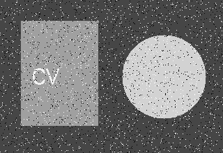
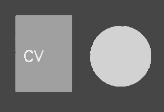

# 第04周讲义｜噪声、滤波与对比度

[本周计划](README.md) · [完整代码](demo.py) · [练习](练习.md)

学习方法：先读直觉和小例子，再看代码；不懂时停下来运行、打印中间值。理解的标准是能预测变化并解释结果，而不是一次读完。


## 1. 去噪为什么不能只把图弄模糊

把一张清晰照片透过毛玻璃看，杂点少了，但文字也不清楚。滤波的难点正是：减少不需要的变化，同时保留真正的结构。先辨认噪声形态，再选择工具，比一上来把核调大更有效。

高斯噪声让很多像素都出现小幅随机明暗变化，像细颗粒；椒盐噪声让少数位置突然变成黑或白，像撒了黑白芝麻。本周用固定随机种子生成它们，让你每次运行得到相同实验条件。种子控制的是伪随机序列，不是去噪强度。

## 2. 核就是一个在图上移动的小窗口

均值滤波把窗口中的数相加除以个数。例如邻域数值是10、10、10、10、255、10、10、10、10，均值约37，异常值255会拉高结果。中值滤波先排序，取中间那个数，这里是10，所以对少量孤立极端值很有效。

高斯滤波也是加权平均，不过中心附近权重大，远处权重小。核大小控制看多大范围，sigma控制权重下降快慢。`GaussianBlur(noisy,(5,5),1.2)` 里的5×5是窗口，1.2是sigma。常见高斯核边长取正奇数，才能明确存在中心像素。

## 3. 对照实验要保持什么不变

想比较核3和核9，必须处理同一张带噪图。如果每次重新随机生成不同噪声，就分不清差别来自参数还是输入。本周练习在循环外生成一次输入，再遍历核大小。

```python
result = cv2.GaussianBlur(noisy, (5,5), 0)
error = np.mean((clean.astype(np.float32) - result.astype(np.float32)) ** 2)
```

sigma为0时由核尺寸推算。第二句是均方误差MSE：每个位置与干净参考图相减，平方后平均。先转浮点特别重要，不然uint8减法与平方都可能溢出。MSE低表示在这个数值指标上接近参考，不等于文字一定最清楚。

## 4. 直方图与对比度

直方图是在数“灰度0有多少像素、1有多少……255有多少”。若大量像素都挤在100～130，整体可能显得灰蒙蒙。增强对比度就是重新分配明暗，让细节更容易看见，但它不能重新创造已经完全丢失的内容。

CLAHE可以理解为分小区域调整明暗，再平滑拼接；`tileGridSize=(8,8)` 指分成8列8行小区域，不是每格8像素。`clipLimit` 用来限制局部增强过头。增强也可能让噪声更显眼，所以不能把“看起来更清楚”直接等同于“去噪成功”。

## 5. 主程序值得逐句停下来的地方

`clean.astype(float)+rng.normal(...)` 先在浮点空间加噪，clip后再保存；`chance<.025` 和 `chance>.975` 分别选择少量椒和盐；`medianBlur(salt,3)` 取3×3邻域中值。打开所有结果，优先对比文字笔画和圆形边界，而不是只看大块背景。

真实照片通常没有“干净参考”，不能直接计算本周的MSE。那时应围绕任务评价，例如后续文字识别率、检测漏检率，并保存相同输入的前后对照图。


## 运行后对照这些结果

得到两种噪声图及处理结果；椒盐噪声经中值滤波后明显减少；较大高斯核会平滑细节，MSE不一定随核变大而降低。

下面图片来自随课程实际运行保存的输出；重新执行程序后图片会更新。

**椒盐噪声**



**中值滤波结果**



更多中间结果在本周 `outputs` 文件夹；数值解释见 [metrics.json](outputs/metrics.json)。

## 查官方文档时看什么

先在官方目录找到本周主题，再看参数、返回值、输入数据类型与例子。官方链接用于核对接口；本讲义中的生活比喻、实验安排和示例代码为本课程编写。

- [OpenCV-Python 官方教程总目录](https://docs.opencv.org/4.x/d6/d00/tutorial_py_root.html)
- [OpenCV 图像处理教程目录](https://docs.opencv.org/4.12.0/d2/d96/tutorial_py_table_of_contents_imgproc.html)
