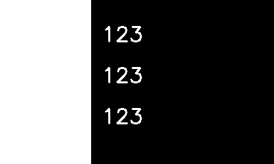
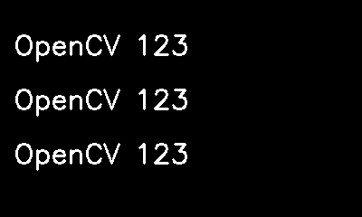

# 第05周讲义｜二值化与形态学

[本周计划](README.md) · [完整代码](demo.py) · [练习](练习.md)

学习方法：先读直觉和小例子，再看代码；不懂时停下来运行、打印中间值。理解的标准是能预测变化并解释结果，而不是一次读完。


## 1. 二值化是在做一道判断题

灰度图有256种亮度，二值图只用两种状态：前景和背景。假设阈值T=100，普通二值化的规则是“大于100变255，其余变0”。输入 `[20,99,100,101,220]` 变成 `[0,0,0,255,255]`。注意等于阈值归哪边，不要凭感觉。

本周纸是亮的、字是暗的，而我们希望字成为白色前景，所以用 `THRESH_BINARY_INV` 反向规则。讲义说“腐蚀让前景缩小”时，默认前景是白色；如果前景反了，你的观察也会反过来。

## 2. 三种阈值解决不同问题

固定阈值：你给一条统一及格线，适合光照相对稳定的情况。Otsu：从整张图灰度分布找一条能较好分开两组的及格线，不需要手填具体T；但它仍只有一条全局线，阴影和复杂分布可能让它失败。

自适应阈值：每个位置参考附近区域，像每个班根据本班情况定线。`blockSize=31` 表示参考31×31邻域，必须是大于1的奇数；`C=9` 从局部统计值中减去9，得到该点的阈值。

```python
mask = cv2.adaptiveThreshold(gray, 255,
    cv2.ADAPTIVE_THRESH_GAUSSIAN_C, cv2.THRESH_BINARY_INV, 31, 9)
```

本例T=局部加权均值-C。因为用的是反向阈值，C变大时T变小，更少像素满足“灰度≤T”，白色前景通常减少。不要死记“C越大字越粗”，必须先看用了哪种二值化方向。

## 3. 腐蚀、膨胀：小印章怎样检查形状

结构元素像一个小印章。对二值白前景，腐蚀要求印章覆盖的相关位置都为白才保留，因此边界向里退；膨胀只要邻域有白就扩展，因此边界向外长。它们处理的是形状，不会理解“这个白点是有用文字还是噪声”。

开运算是先腐蚀再膨胀：孤立小白点先被擦掉，大物体缩小后再扩回，大致形状可保留。闭运算是先膨胀再腐蚀：窄缝和小黑洞先被补上，再收回外边缘。顺序相反，作用不同。

## 4. 核大小决定什么会被吃掉或连接

本例3×3开运算清掉单像素噪声，17×17闭运算尝试填掉半径7的小洞。若把闭运算核继续增大，两个原本独立的物体也可能被连起来。工业计数因此可能从2变成1。

椭圆核与矩形核对斜边、圆角的影响也不同。核不是越大越“强大”，而是定义了你愿意忽略的空间尺度。处理文字时，粗核还会把细笔画擦掉。

## 5. 如何判断中间步骤坏在哪里

先打开灰度输入确认文字和背景确实有亮度区别，再看阈值图，最后看形态学结果。如果阈值阶段已经把两物体大面积连在一起，单靠开运算未必能恢复正确结构。每一步单独保存，才能判断问题发生在颜色、阈值还是形状处理。

主程序 `threshold,otsu=...` 返回两个值：选出的数值阈值，以及二值图。写 `_,mask=...` 表示这次不使用第一个返回值，不是函数只返回图像。


## 运行后对照这些结果

固定阈值会把较暗纸张误当前景；局部阈值能较好分离文字；开运算减少散点，较大的闭运算填补内部黑洞。

下面图片来自随课程实际运行保存的输出；重新执行程序后图片会更新。

**固定阈值**



**局部阈值**



更多中间结果在本周 `outputs` 文件夹；数值解释见 [metrics.json](outputs/metrics.json)。

## 查官方文档时看什么

先在官方目录找到本周主题，再看参数、返回值、输入数据类型与例子。官方链接用于核对接口；本讲义中的生活比喻、实验安排和示例代码为本课程编写。

- [OpenCV-Python 官方教程总目录](https://docs.opencv.org/4.x/d6/d00/tutorial_py_root.html)
- [OpenCV 图像处理教程目录](https://docs.opencv.org/4.12.0/d2/d96/tutorial_py_table_of_contents_imgproc.html)
- [OpenCV 阈值处理教程](https://docs.opencv.org/4.12.0/d7/d4d/tutorial_py_thresholding.html)
