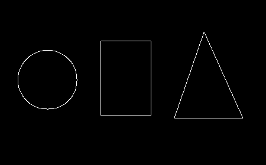
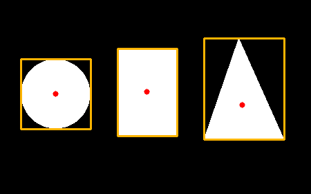

# 第06周讲义｜边缘、轮廓与形状测量

[本周计划](README.md) · [完整代码](demo.py) · [练习](练习.md)

学习方法：先读直觉和小例子，再看代码；不懂时停下来运行、打印中间值。理解的标准是能预测变化并解释结果，而不是一次读完。


## 1. 边缘是“这里变了”，轮廓是“边界连起来了”

从黑背景进入白色物体，亮度突然增加；离开物体又突然减少。Sobel用邻域差分估计这种变化。水平导数对左右亮度变化敏感，因此常突出竖直边。不要把“x方向导数”误解成“只找横线”。

导数可能为负，所以本例先用 `CV_32F` 存浮点梯度，再用 `convertScaleAbs` 转成可显示的绝对强度。若直接把有符号变化塞进uint8，负值信息会丢失。

Canny进一步平滑、计算梯度、压细边缘，并用两道阈值保留强边缘及与强边缘相连的弱边缘。低阈值60、高阈值150不是“灰度必须落在60～150”，它们作用于边缘响应。

## 2. 为什么量面积最好先有填满的物体掩膜

边缘图像画出来的是细线，而分割掩膜画出来的是整个白色物体。要量独立物体的面积，稳定的分割掩膜通常更直接。本周在 `make_shapes` 的填充二值图上找轮廓，避免把边缘断裂误当成对象边界。

`findContours(mask,RETR_EXTERNAL,CHAIN_APPROX_SIMPLE)` 返回轮廓列表和层级关系。`RETR_EXTERNAL` 只关心最外层边界；因此有洞的圆环内边界会被忽略。`CHAIN_APPROX_SIMPLE` 压缩直线段上不必重复保存的点，并不会自动判断形状类别。

## 3. 面积、周长、包围盒是三件事

面积描述覆盖多少平面，周长描述边界走多远，包围盒是能装住它的轴对齐矩形。圆的包围盒包含圆外的背景，所以 `w*h` 不是圆面积。

`contourArea` 计算轮廓围成的几何面积，不等于 `count_nonzero(mask)` 的白像素数量。一个从(0,0)到(10,10)画出的填充矩形可能覆盖11×11个像素中心，而轮廓几何面积是100；两种计量方式不同，不是必有某一个出错。

## 4. 质心可以理解为纸片的平衡点

把白色物体当成均匀纸片，质心是能让它平衡的位置。图像矩里的 `m00` 相当于面积，`m10/m00` 是平均x，`m01/m00` 是平均y。必须先确认m00非零，否则小退化轮廓会触发除零。

```python
M = cv2.moments(contour)
cx = M['m10'] / M['m00']
cy = M['m01'] / M['m00']
```

圆心附近的红点应落在对象内部；若跑到角落，优先检查x、y顺序和使用了哪一条轮廓。

## 5. 从测量走到分类

多边形近似用 `epsilon=.02*perimeter` 决定允许忽略多大边界细节。epsilon太小会留很多点，太大会把真实角点抹掉。本例三个顶点称三角形，四个顶点只能称四边形；若要进一步说是矩形，还需检查角度等条件。

圆度 `4πA/P²` 比较面积A与周长P，理想连续圆为1。数字图上的锯齿和缺口会增大周长，使圆度降低。把它当特征而不是绝对真理：尺寸很小、噪声很多或形状有缺口时，分类阈值要重新验证。

本周流程是“掩膜→外轮廓→去小面积→计算特征→标注”。前两步决定测量对象，后几步才决定结论。若输入分割错了，再精确的公式也只是在测量错误物体。


## 运行后对照这些结果

找到3个物体；质心用红点标出，包围盒为黄色；轮廓多边形近似对应圆形多顶点、矩形4点、三角形3点。

下面图片来自随课程实际运行保存的输出；重新执行程序后图片会更新。

**边缘图**



**物体测量**



更多中间结果在本周 `outputs` 文件夹；数值解释见 [metrics.json](outputs/metrics.json)。

## 查官方文档时看什么

先在官方目录找到本周主题，再看参数、返回值、输入数据类型与例子。官方链接用于核对接口；本讲义中的生活比喻、实验安排和示例代码为本课程编写。

- [OpenCV-Python 官方教程总目录](https://docs.opencv.org/4.x/d6/d00/tutorial_py_root.html)
- [OpenCV 图像处理教程目录](https://docs.opencv.org/4.12.0/d2/d96/tutorial_py_table_of_contents_imgproc.html)
