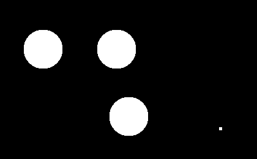
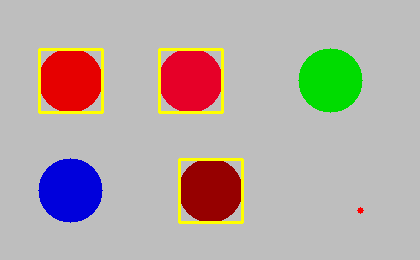

# 第07周讲义｜颜色识别与目标计数

[本周计划](README.md) · [完整代码](demo.py) · [练习](练习.md)

学习方法：先读直觉和小例子，再看代码；不懂时停下来运行、打印中间值。理解的标准是能预测变化并解释结果，而不是一次读完。


## 1. 为什么直接比较“红通道大”不够可靠

白色的B、G、R都很大，单看R高会把白色也当红色。光照变暗时，同一个红物体的R又会降低。HSV把颜色拆成色相H、饱和度S、明亮程度V，让“是什么颜色”和“有多亮”更容易分别设条件。

可以把H想成绕一圈的调色盘，S想成颜色有多纯，V想成灯开得多亮。灰色的S很低，即便它算出某个H，也不应被当作鲜艳颜色。纯黑位置的色相尤其没有可靠解释。

## 2. 红色为什么需要两段范围

本课使用uint8图像和普通 `COLOR_BGR2HSV`，H常用范围为0～179，S和V为0～255。红色恰好跨越色相环首尾：接近0与接近179都可能是红色。不要照搬浮点HSV或HSV_FULL的数值范围。

```python
low = cv2.inRange(hsv, (0,100,70), (10,255,255))
high = cv2.inRange(hsv, (170,100,70), (179,255,255))
mask = cv2.bitwise_or(low, high)
```

`inRange` 要求同一个像素三个分量都落在对应上下界内，边界包含在内。两张掩膜做“或”，表示满足任意一个红色区间都保留。S≥100排除偏灰色，V≥70排除过暗像素，这些都是本例假设，不是红色的自然定律。

## 3. 连通域是在数“粘在一起的白色岛屿”

连通域将相邻白像素归为同一对象。4邻域只看上下左右；8邻域还把斜角相邻算连通。本例使用8邻域。

函数返回标签数量n、每个像素的标签图labels、每个对象的统计stats、中心centers。0号通常是背景，所以循环从1开始。`stats[label]` 给出x、y、宽、高、像素面积；此处面积确实是像素计数，与上周的轮廓几何面积不是同一种定义。

面积小于200的连通域被过滤，能去掉示例中的小红点。但是两颗红球碰在一起会形成一个连通域，计数就会少1。第13周再处理粘连，这周先明确方法边界。

## 4. 三个亮度实验要看哪里

参考答案把同一张图乘以0.25、0.5、1.0。H可能仍接近红色，S也不一定下降，但V会显著降低，所以某些目标不再满足V≥70。你应同时打开结果图与记录表，确认漏掉的是哪些物体，而不是看到数量不对就随机降低所有门槛。

降低V下界可能找回暗红目标，也可能引入暗处噪声。真正稳定的方案通常先改善照明，再根据验证数据调整阈值。HSV有助于拆开条件，却不能让颜色检测免受所有光照影响。

## 5. 用误检和漏检描述效果

真实目标3个，检测结果中有2个是真目标、另1个是假目标：精确率为2/3，召回率为2/3。若结果数也等于3，仍不代表检测正确。因此计数相同只能是初步检查，最好对照位置确认每一个目标。

本周程序画出了包围盒，正是为了让你检查“找对了谁”。进入项目阶段后，除了总数，也要保存位置和失败样例。


## 运行后对照这些结果

标准场景检测3个大红色圆，忽略小红点和其他颜色；降低亮度后部分或全部红色物体会因为V门槛漏检。

下面图片来自随课程实际运行保存的输出；重新执行程序后图片会更新。

**红色掩膜**



**目标计数**



更多中间结果在本周 `outputs` 文件夹；数值解释见 [metrics.json](outputs/metrics.json)。

## 查官方文档时看什么

先在官方目录找到本周主题，再看参数、返回值、输入数据类型与例子。官方链接用于核对接口；本讲义中的生活比喻、实验安排和示例代码为本课程编写。

- [OpenCV-Python 官方教程总目录](https://docs.opencv.org/4.x/d6/d00/tutorial_py_root.html)
- [OpenCV 图像处理教程目录](https://docs.opencv.org/4.12.0/d2/d96/tutorial_py_table_of_contents_imgproc.html)
