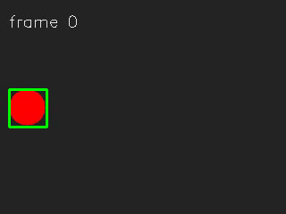
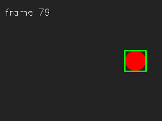

# 第08周讲义｜视频处理与逐帧流水线

[本周计划](README.md) · [完整代码](demo.py) · [练习](练习.md)

学习方法：先读直觉和小例子，再看代码；不懂时停下来运行、打印中间值。理解的标准是能预测变化并解释结果，而不是一次读完。


## 1. 视频就是按时间顺序播放的图片

20FPS表示每秒播放20帧，80帧对应4秒。每帧是普通BGR数组，所以前几周的处理函数可以直接放进循环。视频多出来的问题是时间顺序、读写状态与资源管理。

程序处理速度可能每秒数百帧，但输出视频仍按写入时设置的20FPS播放。源视频帧率、每秒实际处理量、窗口等待时间是三种不同概念。

## 2. 读取过程像不断从传送带拿盒子

```python
cap = cv2.VideoCapture(path)
while True:
    ok, frame = cap.read()
    if not ok:
        break
    # 此时才可以处理frame
```

`isOpened` 只说明视频源成功打开，不保证之后每次读帧都成功。`read` 返回ok与frame，文件读完时ok会变False，设备异常也可能如此。不要先使用frame，再去判断ok；失败时frame可能是None。

本课先自动生成视频，再重新读取，模拟真实文件流程，不需要你拥有摄像头。主程序还限制最多处理300帧，防止初学者打开摄像头后不知道如何结束。

## 3. 写视频必须遵守约定

创建 `VideoWriter` 时要给出路径、编码格式、帧率和尺寸。这里选择MJPG写AVI，尺寸为 `(320,240)`，传入的帧必须与尺寸和通道约定一致。把240×320写反可能得到打不开的文件。

writer也要检查 `isOpened`，因为不同机器的编码器支持不完全相同。每次 `write(frame)` 是加入一帧，最终 `release()` 才能确保容器正确结束。文件已经存在并不等于视频一定写完整。

## 4. 为什么要用try/finally

`try` 中完成正常工作，`finally` 无论循环正常结束还是中途出错都会执行。把 `cap.release()`、`writer.release()` 放在finally里，相当于保证借来的设备和文件句柄最终归还。否则摄像头可能继续被占用，视频也可能无法正常播放。

每一帧的算法依然是HSV→红色掩膜→轮廓→面积过滤→画框。先把这些步骤在一张图上调通，再迁移到视频，能把视觉错误和读写错误分开排查。

## 5. 可选窗口和摄像头

默认不弹窗，直接看outputs。运行 `python demo.py --show` 时才打开预览，按Q退出。`waitKey` 一方面给窗口事件处理留时间，另一方面本例用它近似控制播放速度；处理很慢时，这并不构成精确的实时播放调度。

`python demo.py --camera 0 --show` 会使用0号摄像头。它需要真实设备、系统授权和带GUI的OpenCV环境；本课程默认验证不包含摄像头。换成headless包可以跑无窗口示例，却无法使用本例预览。

## 6. 抽帧要想清楚时间单位

本例固定20FPS，所以 `index % 20 == 0` 每20帧保存一张，对应0、1、2、3秒。换成30FPS视频仍每20帧取一张，就不再是每秒一次。处理可变帧率文件时应进一步按时间戳采样，而不是默认帧间隔恒定。

输出的循环FPS包含读取、处理、写入和可选窗口等待，它用于粗略观察整条流程速度，不是纯算法性能基准。


## 运行后对照这些结果

生成320×240、20FPS、80帧的输入和标注AVI，约4秒；红球周围有绿色框；参考答案抽出索引0、20、40、60的4张图片。

下面图片来自随课程实际运行保存的输出；重新执行程序后图片会更新。

**第0帧**



**第79帧**



更多中间结果在本周 `outputs` 文件夹；数值解释见 [metrics.json](outputs/metrics.json)。

## 查官方文档时看什么

先在官方目录找到本周主题，再看参数、返回值、输入数据类型与例子。官方链接用于核对接口；本讲义中的生活比喻、实验安排和示例代码为本课程编写。

- [OpenCV-Python 官方教程总目录](https://docs.opencv.org/4.x/d6/d00/tutorial_py_root.html)
