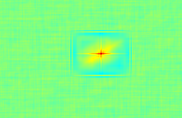
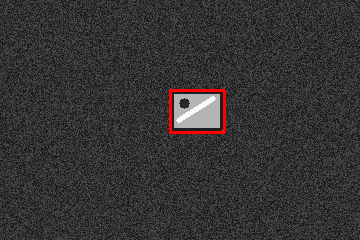

# 第09周讲义｜模板匹配与相似度

[本周计划](README.md) · [完整代码](demo.py) · [练习](练习.md)

学习方法：先读直觉和小例子，再看代码；不懂时停下来运行、打印中间值。理解的标准是能预测变化并解释结果，而不是一次读完。


## 1. 模板匹配像拿一个小图章找相同花纹

有一张小图片，比如一个固定按钮，你想知道它出现在大截图的哪里。模板匹配将小图在大图上逐位置滑动，每次比较覆盖区域与模板是否相似，再把结果写进一张响应图。

它并不理解“这是按钮”，只比较图像模式。因此当按钮改变大小、旋转或外观时，即便人眼还认为是同一个东西，匹配也可能变差。

## 2. 响应图中的坐标是什么

大图宽W、模板宽w，小图最右侧还能放下的位置是W-w，所以横向有W-w+1个位置。高度同理。本例大图240×360，模板42×54，响应shape是 `(240-42+1,360-54+1)=(199,307)`。

响应图某处值代表“将模板左上角放在这里时的匹配分数”，不是目标中心，也不是完整物体掩膜。找到 `(x,y)` 后，框的另一角应为 `(x+w,y+h)`。

```python
response = cv2.matchTemplate(image, template, cv2.TM_CCOEFF_NORMED)
_, score, _, point = cv2.minMaxLoc(response)
```

`minMaxLoc` 返回最小值、最大值、最小值位置、最大值位置。本例取最大值，因为所选方法分数越大越相似。若换成SQDIFF类方法，应找最小值，不能只换常量却不改后面的逻辑。

## 3. 归一化相关分数不是概率

本例方法先去掉平均亮度再比较变化模式，可以理解为比较“哪里亮、哪里暗的走势”是否接近。得分常在-1～1附近，1代表非常一致，但0.9不等于“90%的概率有目标”。阈值0.8只是演示门槛，必须用自己的正负样本验证。

若模板是一整块相同灰色，去掉均值后不再有变化，相关系数会遇到退化情况。因此代码检查 `template.std()`，标准差接近0就拒绝。给模板增加真实纹理比强行解释退化分数可靠。

即使整张图根本没有目标，响应图仍存在最大值。程序应同时判断分数是否达到要求，不能把“找到最像的位置”直接写成“找到目标”。

## 4. 多尺度搜索怎么做

练习把目标放大到原来的1.5倍，再将模板分别缩放为0.75、1、1.25、1.5、1.75倍。每个尺度各做一次匹配，记录其最高分和位置，再比较候选。它以更多计算换取对部分大小变化的适应能力。

这仍不是任意尺度不变：真实大小落在两个尝试值之间时，分数可能降低；旋转问题也没有自动解决。如果图像里有多个相同模板，只取一个最大值也无法完整计数，需要找多个峰值并抑制相互重叠的重复框。

## 5. 主程序为什么使用有纹理的合成模板

矩形边框、斜线和小圆形成不对称图案，比纯色块更有辨识度。模板被原样粘贴到图里，提供已知答案(170,90)。这是检查代码和坐标的理想实验；加入噪声、缩放和相似干扰后，才是在测试方法稳健性。

阅读热力图时，红色表示映射后的较高响应，颜色只是展示方式；实际判断应读原始分数。不要把热力图保存后的颜色值再当成相关系数。


## 运行后对照这些结果

主例定位左上角(170,90)，分数接近1；240×360图与42×54模板产生199×307响应图；尺度练习最佳项为1.5附近。

下面图片来自随课程实际运行保存的输出；重新执行程序后图片会更新。

**匹配响应图**



**最佳位置**



更多中间结果在本周 `outputs` 文件夹；数值解释见 [metrics.json](outputs/metrics.json)。

## 查官方文档时看什么

先在官方目录找到本周主题，再看参数、返回值、输入数据类型与例子。官方链接用于核对接口；本讲义中的生活比喻、实验安排和示例代码为本课程编写。

- [OpenCV-Python 官方教程总目录](https://docs.opencv.org/4.x/d6/d00/tutorial_py_root.html)
- [OpenCV 图像处理教程目录](https://docs.opencv.org/4.12.0/d2/d96/tutorial_py_table_of_contents_imgproc.html)
