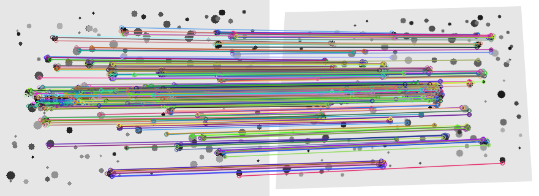
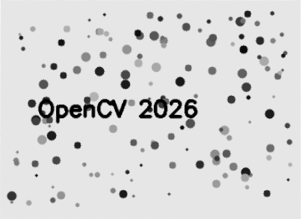

# 第10周讲义｜特征匹配与图像对齐

[本周计划](README.md) · [完整代码](demo.py) · [练习](练习.md)

学习方法：先读直觉和小例子，再看代码；不懂时停下来运行、打印中间值。理解的标准是能预测变化并解释结果，而不是一次读完。


## 1. 从“整张小图匹配”改成“找有辨识度的路标”

城市地图中整条街形状可能变化，但路口、门牌这样的路标更容易对应。关键点是图中值得记住的位置，描述子则记录其附近外观，好比给每个路标附一张小名片。关键点回答“在哪”，描述子回答“附近像什么”。

ORB会在图像金字塔上找角点并描述局部模式，适应一定的缩放和旋转。它不是任意角度、任意尺度都有效；强模糊、无纹理和重复图案仍会造成问题。

## 2. 汉明距离是在比较二进制名片

ORB常用二进制描述子，可以看成一串0和1。汉明距离统计不同位的数量：`1011` 与 `1001` 只有一位不同，距离为1。距离越小表示描述子越接近，但不自动证明两个点来自同一物体。

```python
matcher = cv2.BFMatcher(cv2.NORM_HAMMING)
pairs = matcher.knnMatch(d1, d2, k=2)
```

对第一张图每个描述子，找第二张图中最接近的两位候选。若用的是其他描述子类型，距离类型可能要变化；不要把所有特征统一套汉明距离。

## 3. 比率筛选关注“第一名领先多少”

第一名距离20、第二名距离22，说明两位都差不多，匹配含糊；第一名20、第二名60，则第一名明显领先。条件 `best.distance < 0.75*second.distance` 保留第二种情况。

这个比率是两段距离的比，不是“匹配可信度75%”。门槛变成0.55会更严格，0.95会更宽松。匹配数多不一定更好，错误对应也可能一起增加。代码先检查一组是否真的有两个候选，避免对不足两个的结果强行拆包。

## 4. RANSAC用几何一致性再检查一次

比率筛选只看局部外观，重复窗户可能仍配错。RANSAC反复用少量对应点提出一个H，再看多少其他对应也同意这个几何关系。赞同的叫内点，明显不一致的叫外点。

本例 `findHomography(...,cv2.RANSAC,3.0)` 中3.0是以像素计的几何误差容忍门槛，不是3%。至少4对非退化对应点才能确定一个一般的平面单应关系；点都挤在一条线附近时，即使数量够也可能不稳定。

## 5. 方向一定要弄清楚

我们从第一张图的点p1对应到第二张图p2，估计的H是“第一张→第二张”。想把第二张图拉回第一张，就用H的逆。忘记方向，是对齐时图片飞出去的常见原因。

主例知道用于合成数据的真实H，因此能把四个原图角点分别送入真实H和估计H，计算平均距离。直接比较H各元素不如比较像素位置直观，因为单应矩阵乘一个非零尺度也表示同一映射。

## 6. 做出来的匹配线还需要看

`03_inlier_matches.png` 只画RANSAC认可的匹配。线条大致应遵守相同的空间变化。如果“有很多线”但方向杂乱，应检查图案重复、门槛和几何模型。

单个H适合近似同一平面的内容，或某些纯相机旋转场景。有前后景深度差且相机平移时会产生视差，不能指望一个H把所有物体都对齐。本周合成平面很理想，真实场景要补充验证。


## 运行后对照这些结果

得到参考图、透视图、内点匹配图和对齐图；至少有4个内点，合成图的平均角点误差应小于5像素，具体匹配数量以当前结果为准。

下面图片来自随课程实际运行保存的输出；重新执行程序后图片会更新。

**几何一致的匹配点**



**图像对齐结果**



更多中间结果在本周 `outputs` 文件夹；数值解释见 [metrics.json](outputs/metrics.json)。

## 查官方文档时看什么

先在官方目录找到本周主题，再看参数、返回值、输入数据类型与例子。官方链接用于核对接口；本讲义中的生活比喻、实验安排和示例代码为本课程编写。

- [OpenCV-Python 官方教程总目录](https://docs.opencv.org/4.x/d6/d00/tutorial_py_root.html)
- [OpenCV ORB 教程](https://docs.opencv.org/4.x/d1/d89/tutorial_py_orb.html)
