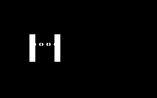
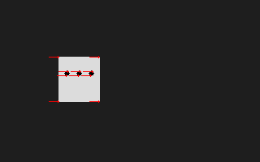

# 第11周讲义｜运动检测与光流

[本周计划](README.md) · [完整代码](demo.py) · [练习](练习.md)

学习方法：先读直觉和小例子，再看代码；不懂时停下来运行、打印中间值。理解的标准是能预测变化并解释结果，而不是一次读完。


## 1. 三种方法其实回答不同问题

帧差问：“跟上一张图相比，哪些位置变了？”背景减除问：“哪些位置不像我学过的背景？”光流问：“某些图像纹理似乎移动到了哪里？”它们相关，但输出含义不同，不能互相替代解释。

本例只用两帧静态图片理解核心计算，避免视频读写分散注意力。下一步可把同样逻辑放进第8周循环，连续保存前一帧与当前帧。

## 2. 帧差为什么常出现两块亮区域

一个白色方块从左边移到右边，旧位置由白变黑、新位置由黑变白。`absdiff` 对两种变化都给正值，再阈值化后两边都亮。因此帧差反映变化，不一定填满“当前物体”的内部。

必须用绝对差或合适的浮点运算，不能直接做uint8 `current-previous`，否则负差会回绕。对慢动作，变化可能很弱；对全画面光线变化，很多像素都会变。

## 3. 背景模型像学会“平时这里长什么样”

MOG2为每个位置维护随时间变化的统计背景模型。本周先用30张相同空背景热身，再把含物体的新帧传进去。`learningRate=0` 暂时冻结模型，确保演示时新物体不会被立刻吸收。

真实视频通常需要持续缓慢更新背景，适应自然变化；但物体长时间不动时可能逐渐成为背景。打开阴影检测时，掩膜还可能包含阴影值，不能未经判断就把所有非零像素当成真实目标。本例关闭了阴影检测。

## 4. 光流跟踪的是局部纹理，不是物体身份

先用 `goodFeaturesToTrack` 找有辨识度的角点，再用Lucas–Kanade方法在下一帧寻找相似小邻域。直觉上，它假设短时间内局部亮度模式较稳定、位移在搜索能力范围内。多层金字塔让算法先在缩小图上估计较大移动，再逐层细化。

```python
moved, status, error = cv2.calcOpticalFlowPyrLK(
    first_gray, second_gray, points, None,
    winSize=(21,21), maxLevel=3)
```

返回moved是新位置，status指示跟踪是否成功，error提供误差信息。程序至少过滤status失败和非有限坐标；更严格的实现还应限制误差、做前后向一致性检查、剔除越界点。

## 5. 用一个可手算的结果建立信心

矩形从x=60移到x=72，理论位移为 `(72-60,0)=(12,0)`。每个点的估计有细微差异，所以主程序汇总中位数，减少少量异常点的影响。结果接近12说明这个理想场景下实现合理，不代表任意视频都准确。

如果两帧间隔0.05秒，12像素位移对应240像素/秒。想换成米/秒，需要空间尺度、相机几何或场景约束，不能把像素直接当厘米。

## 6. 光照反例揭示了什么

练习保持物体位置不变，只把整张图增亮35。帧差阈值为25，大量像素会触发变化。算法没有“犯算术错误”，而是你把“亮度变化”解释成了“物体运动”。真实系统应结合背景更新、曝光控制和更多线索判断。

相机自己移动时，背景纹理也在移动。若任务要求检测独立运动物体，先估计并补偿相机运动可能很重要，但也会受视差影响。这属于本周之后的扩展，而不是把阈值调高就一定能解决。


## 运行后对照这些结果

两帧矩形向右移动12像素；光流中位位移接近(12,0)；帧差突出新旧位置差异，背景法更接近完整物体；光照变化反例产生大范围报警。

下面图片来自随课程实际运行保存的输出；重新执行程序后图片会更新。

**帧差掩膜**



**光流运动方向**



更多中间结果在本周 `outputs` 文件夹；数值解释见 [metrics.json](outputs/metrics.json)。

## 查官方文档时看什么

先在官方目录找到本周主题，再看参数、返回值、输入数据类型与例子。官方链接用于核对接口；本讲义中的生活比喻、实验安排和示例代码为本课程编写。

- [OpenCV-Python 官方教程总目录](https://docs.opencv.org/4.x/d6/d00/tutorial_py_root.html)
