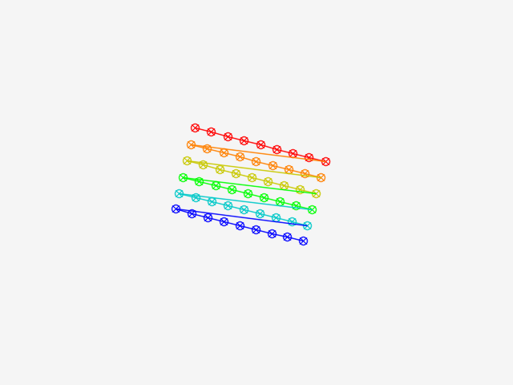

# 第12周讲义｜相机成像与标定入门

[本周计划](README.md) · [完整代码](demo.py) · [练习](练习.md)

学习方法：先读直觉和小例子，再看代码；不懂时停下来运行、打印中间值。理解的标准是能预测变化并解释结果，而不是一次读完。


## 1. 为什么同一个杯子远处看起来更小

简化的小孔相机把三维点投影到图像。若物体到相机的深度Z增加一倍，横向投影大致缩小一半。最基本关系是 `u=fx*X/Z+cx`、`v=fy*Y/Z+cy`。X、Y、Z属于相机坐标，u、v是图像像素坐标。

例如X=0.1米、Z=1米、fx=800像素、cx=320像素，则u=400像素；Z变成2米，u=360像素，更靠近中心。现在先理解比例，不要求从头推导射影几何。

## 2. 内参、外参、畸变分别在讲什么

内参K描述相机的成像尺度与主点，核心是fx、fy、cx、cy。外参描述当前棋盘相对于相机如何旋转和平移，每张照片姿态可以不同。畸变描述实际镜头相对于理想小孔模型的偏差，例如画面边缘的直线弯曲。

焦距fx、fy在K里以像素为单位，不直接是镜头标注的毫米数。畸变系数也不是“几像素”的偏移，它们参与归一化坐标的非线性计算。改变对焦、变焦、裁切或分辨率后，应检查原参数是否仍适用。

## 3. 标定是在用已知尺子反推相机

棋盘提供已知位置的点。若每格边长0.025米，板面点可写 `(列号×0.025,行号×0.025,0)`。拍摄后，我们知道这些点落在图片的哪些像素，就能用多张不同姿态照片求一组解释这些对应关系的相机参数。

9×6内角点不是9×6格子。普通完整棋盘通常要10×7个方格才有9×6个内部交点。行列顺序写错，角点检测可能失败。`cornerSubPix` 会在初始角点附近进一步细化位置，避免只能精确到整数像素。

## 4. 先在知道答案的条件下做实验

本周主程序设置真实K与畸变，使用 `projectPoints` 生成18个姿态下的角点观测，再用 `calibrateCamera` 反求参数。你既知道出题答案，又能看估计结果，非常适合理解每个输入输出。

这不是拿一张棋盘截图就标定自己的摄像头。保存的 `synthetic_calibration.npz` 只属于模拟相机，不能用于真实设备。本周真实图像角点检测另放在 `calibrate_real.py`。

## 5. 重投影误差到底在比较什么

给定估计相机和每张棋盘姿态，将已知三维点重新投到图像，再与实际观测角点比较。每点二维距离的平方先平均，再开平方，得到这里的RMS，单位像素。代码独立重算一遍，便于和函数返回值对照。

低误差说明参数能解释这些观测，不保证镜头已被完美校正。照片姿态过于重复、角点覆盖不足或模型不适用时，参数可能不稳。应查看逐图误差、图像边缘直线，以及未参与标定的新照片，而不只追求一个小数字。

## 6. 真正拍摄时怎样做

准备平整、尺寸已测量的棋盘，让整块板在每张图里完整可见；收集15～25张清晰照片，包含远近变化、不同倾角以及画面中心和四周。保持同一分辨率、焦距和对焦条件，避免弯曲棋盘、反光、运动模糊以及只拍正对镜头的重复姿态。

把照片放在自己的目录，在本周文件夹运行：

```powershell
python calibrate_real.py "D:/你的棋盘照片" --cols 9 --rows 6 --square 0.025
```

路径是示意，必须替换。程序会保存角点可视图、逐图误差、相机参数和一张去畸变图；至少10张有效照片是本课程的质量门槛，不是OpenCV唯一的数学最低要求。此脚本使用普通针孔畸变模型，超广角鱼眼应另学fisheye模型。


## 运行后对照这些结果

理想合成数据重投影RMS接近0，估计焦距接近800和810像素；噪声增大时参数可能变得不稳定；输出标定文件只属于模拟相机。

下面图片来自随课程实际运行保存的输出；重新执行程序后图片会更新。

**模拟相机中的棋盘角点观测**



更多中间结果在本周 `outputs` 文件夹；数值解释见 [metrics.json](outputs/metrics.json)。

## 查官方文档时看什么

先在官方目录找到本周主题，再看参数、返回值、输入数据类型与例子。官方链接用于核对接口；本讲义中的生活比喻、实验安排和示例代码为本课程编写。

- [OpenCV-Python 官方教程总目录](https://docs.opencv.org/4.x/d6/d00/tutorial_py_root.html)
- [OpenCV 相机标定接口与模型说明](https://docs.opencv.org/4.x/d9/d0c/group__calib3d.html)
