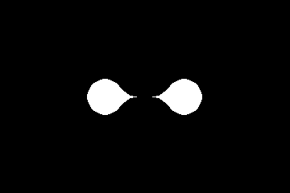
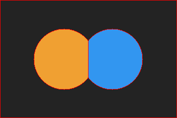

# 第13周讲义｜分开粘连目标：分水岭

[本周计划](README.md) · [完整代码](demo.py) · [练习](练习.md)

学习方法：先读直觉和小例子，再看代码；不懂时停下来运行、打印中间值。理解的标准是能预测变化并解释结果，而不是一次读完。


## 1. 为什么上一周的计数方法在这里不够

连通域将接触的白像素当成同一座岛，两个圆只要连起来就会算作一个。想把它们分开，需要额外线索：“虽然边界接触，但内部似乎存在两个中心”。距离变换提供这种线索。

本周图中的两个圆略微重叠，意味着你看不到它们全部原始边界。分水岭得到的是一种合理划分，不等于恢复不可见的真实轮廓。

## 2. 距离变换像测“离海岸还有多远”

把白前景当陆地、黑背景当海水。每个白像素的距离值表示到最近黑色像素有多远。边界附近很小，物体内部比较大；圆中心附近最远。

`distanceTransform(mask,DIST_L2,5)` 使用欧氏距离的近似计算。显示前用normalize把浮点距离映射到0～255，仅为方便看图；真正的种子计算仍使用原始距离数值，不应该误用彩色热力图。

## 3. 种子先回答“哪里肯定属于一个物体内部”

主例保留 `distance > 0.65*distance.max()` 的区域。这里0.65是全图最大距离的比例，不是每个物体面积的65%。适当比例可只留下两个圆心附近的小岛，再给它们不同标签。

比例过低，圆间的连接处也被保留，种子就粘成一个；过高，小物体或扁平物体可能一个种子也没有。用同一全局比例处理大小差异很大的物体会出问题，此时可研究局部峰值或人工标记。

## 4. 四种标记值要分清

`connectedComponents` 得到背景0、前景1和2。分水岭约定0表示“未知”，所以代码先把全部标签加1：已知背景变成1，两个对象变成2和3。再把还没分配的过渡区域设置为0。

```python
markers = markers.astype(np.int32) + 1
markers[unknown > 0] = 0
cv2.watershed(image, markers)
```

输入图是3通道uint8，markers是单通道int32。函数会原地改写markers，最终分界线标成-1。若把markers强行转成uint8，-1就不能按原意保存，既可能报错也会让解释混乱。

代码中的 `sure_bg` 来自膨胀后的前景包络，它表示前景可能扩展到的范围；包络外才是确定背景。`unknown=sure_bg-sure_fg` 标出“既不是确定内部、也不在确定背景外侧”的待分配带。变量名容易让人误以为膨胀白区本身全是背景，要结合掩膜逻辑理解。

## 5. 分水岭的直觉

想象不同种子各自开始向周围扩展，遇到图像变化与其他区域时决定边界。用“从不同山谷灌水，交界处筑堤”可以记住名称，但具体接口以图像颜色差异和标记驱动，不是直接把距离图当成唯一地形。

本例距离图负责找种子，原彩色图负责分水岭划分。两步各有职责。若种子错了，后面的算法通常不会神奇地猜出缺少的物体。

## 6. 怎么评价分得好不好

先看数量是否从1变2，再看边界是否合理。数量对了也可能一边分得太大、一边太小。若有真实标注，可对每个对象计算交并比IoU：预测与真实共同区域面积，除以两者合起来的面积。例如交集80、并集100，IoU=0.8。

本课没有宣称为粘连圆生成可见之外的精确真值边界，只验证种子和区域数量。换成真实药片、细胞或零件时，应人工标注样本，分别考察过分割和欠分割。


## 运行后对照这些结果

两个粘连圆在原始掩膜中是1个连通对象，主例分成2个区域；种子比例过低时可能只留下1个种子，无法正确分开。

下面图片来自随课程实际运行保存的输出；重新执行程序后图片会更新。

**两个前景种子**



**分水岭分离结果**



更多中间结果在本周 `outputs` 文件夹；数值解释见 [metrics.json](outputs/metrics.json)。

## 查官方文档时看什么

先在官方目录找到本周主题，再看参数、返回值、输入数据类型与例子。官方链接用于核对接口；本讲义中的生活比喻、实验安排和示例代码为本课程编写。

- [OpenCV-Python 官方教程总目录](https://docs.opencv.org/4.x/d6/d00/tutorial_py_root.html)
- [OpenCV 分水岭教程](https://docs.opencv.org/4.x/d3/db4/tutorial_py_watershed.html)
