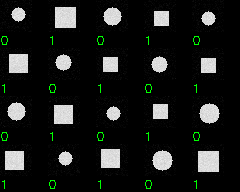

# 第14周讲义｜从手写规则到机器学习

[本周计划](README.md) · [完整代码](demo.py) · [练习](练习.md)

学习方法：先读直觉和小例子，再看代码；不懂时停下来运行、打印中间值。理解的标准是能预测变化并解释结果，而不是一次读完。


## 1. 不再手写每一种判断规则

第6周用顶点数和圆度判断形状，是我们直接制定规则。机器学习则先选择描述图像的数值，再给出带答案的样本，让算法学习这些数值与类别之间的关系。本课依然只区分圆与正方形，重点是学会完整实验流程。

“模型学到了”不等于它理解了圆的数学定义。它可能只是找到训练数据中很管用的外观差别，所以必须给它没见过的数据考试。

## 2. HOG：把局部边缘方向变成一张统计表

HOG观察每个小区域中，横向、竖向、斜向变化各有多少。像统计一小片街区里道路朝哪个方向延伸，再把多个区域的统计拼起来。方形的直边与圆形的弧线会形成不同方向分布。

本例统一32×32灰度输入，8×8像素为一个小格，16×16为一个块，块每次移动8像素，每格分9个方向区间。横纵各有3个块位置，每块4格，所以特征长度为 `3×3×4×9=324`。

归一化有助于减弱部分亮度差异，但HOG不会自动解决任意旋转。不要把“局部统计”误当成完全不变的形状描述。

## 3. SVM在特征空间里划分两类

可以先想象每张图只有两个特征，所有图片落在二维平面上，分类器要找到一条线把两类分开。真正的HOG有324维，难以画出，但“根据特征划分两类”的思路仍一样。

```python
svm = cv2.ml.SVM_create()
svm.setType(cv2.ml.SVM_C_SVC)
svm.setKernel(cv2.ml.SVM_LINEAR)
svm.setC(1.0)
svm.train(features, cv2.ml.ROW_SAMPLE, labels)
```

每一行features是一张图的特征，使用float32；labels是对应整数类别，0为圆、1为正方形。C控制对训练错误的惩罚程度，不是“准确率目标1.0”。本课先固定C学流程，不在测试集上反复调参。

## 4. 训练集和测试集为什么必须分开

训练样本像平时练习题，测试样本像考试新题。用同一张图训练后再考试，分数很高也可能只是记住了样本。代码用种子42生成240张训练图，用种子2026生成100张新测试图，避免直接重复相同噪声与几何样本。

这仍只是来自同一个简单生成规则的新样本，不等于真实世界。若要选择参数，应另留验证集，用验证集做选择，最后只在保留的测试集上评估一次。视频中相邻帧非常相似，应按拍摄批次、对象或场景划分，避免近重复图片跨集合。

## 5. 混淆矩阵怎么读

本课矩阵“行是真实类别、列是预测类别”。假设矩阵为 `[[45,5],[10,40]]`，意思是50个圆中45个判对、5个判成方；50个方中10个判成圆、40个判对。总准确率为85/100=85%。

只看总准确率可能掩盖某一类几乎全错。若任务关心缺陷漏检，就应单独看缺陷类召回率，而不是让大量正常样本撑起漂亮总分。

## 6. 旋转测试是一堂很重要的失败课

练习保持训练不变，只将测试形状旋转20度和45度。在当前验证环境，同分布测试准确率为1.0，旋转后降到0.5，方形大量被判成圆。这清楚说明模型利用了训练分布中稳定的边缘方向，而不是人类意义上的形状概念。

改进可从覆盖真实姿态的训练样本、适当的数据增强或更合适特征入手，再用独立数据检验。不要反复看同一测试集结果后调整，再把它当成从未见过的测试。

本周不训练深度网络，也不声称已覆盖现代检测。它为后续学习深度学习的数据划分、特征、评价和泛化概念打基础。


## 运行后对照这些结果

对同一合成分布的圆/正方形分类表现较好，特征维度为324；旋转测试会暴露泛化问题；每次结果写入JSON，而不预设真实应用准确率。

下面图片来自随课程实际运行保存的输出；重新执行程序后图片会更新。

**0为圆，1为正方形**



**旋转后的测试输入**


更多中间结果在本周 `outputs` 文件夹；数值解释见 [metrics.json](outputs/metrics.json)。

## 查官方文档时看什么

先在官方目录找到本周主题，再看参数、返回值、输入数据类型与例子。官方链接用于核对接口；本讲义中的生活比喻、实验安排和示例代码为本课程编写。

- [OpenCV-Python 官方教程总目录](https://docs.opencv.org/4.x/d6/d00/tutorial_py_root.html)
