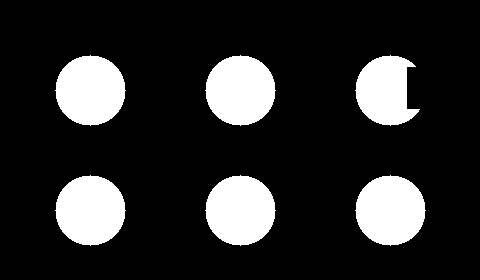
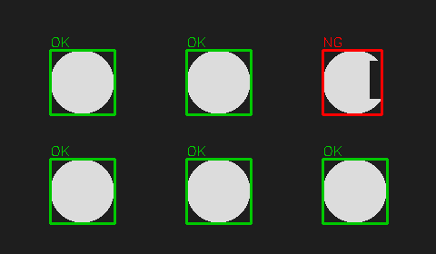

# 第15周讲义｜项目一：零件计数与缺陷检测

[本周计划](README.md) · [完整代码](demo.py) · [练习](练习.md)

学习方法：先读直觉和小例子，再看代码；不懂时停下来运行、打印中间值。理解的标准是能预测变化并解释结果，而不是一次读完。


## 1. 项目开始先写清“什么情况下要有效”

需求如果只是“检测所有零件缺陷”，几乎无法验证。本项目缩小到可观察范围：相机基本垂直，背景偏暗，零件偏亮，形状应近似圆，彼此分离，零件轮廓完整。缺陷只演示明显边缘缺口，不包含细微裂纹、颜色变化、内部材质问题。

这些条件不是逃避难题，而是定义当前方案的使用边界。以后需求扩大，再有针对性地增加光照、分割或更复杂模型。

## 2. 把流水线拆成能检查的阶段

`make_parts` 生成可重复且有已知答案的场景。`inspect` 只接收图像和参数，返回掩膜、标注图、测量报告；它不负责解析命令行或寻找文件。`main` 负责输入输出。这种分工让练习脚本能重复调用同一算法，减少复制粘贴后逻辑不一致。

流程是：灰度化→固定阈值→找外轮廓→去掉过小区域→计算圆度→输出OK/NG。每一步承接前一步的假设，例如只有正确分开的白色区域，才适合当作独立零件。

## 3. 为什么缺口会影响圆度

完整圆以较小周长包围较大面积，理论圆度为1。缺口通常减少面积并增加边界曲折程度，使 `4πA/P²` 降低。本例完整圆约0.886，缺口件约0.642，所以门槛0.84能分开这组合成样本。

0.84不是工业通用标准。像素分辨率、轮廓锯齿、相机倾角与真实零件公差都会影响圆度。应先收集已标注的正常/缺陷样本，在验证集上选择门槛，然后报告独立测试结果。

## 4. 可配置参数与可追溯输出

```powershell
python demo.py --threshold 110 --min-area 400 --min-circularity 0.84
python demo.py --input "D:/你的图片/零件.png"
```

第一条可直接运行，第二条需换成真实存在的路径。阈值控制哪些亮度成为前景；最小面积排除小区域；最小圆度决定形状是否合格。报告保存当前配置以及每个对象的面积、圆度和包围盒，便于复现，而不是只留下“发现1个缺陷”这句话。

所有像素阈值都与尺度相关。把图片分辨率增大一倍，面积大约变四倍。面积门槛不跟随调整，可能改变哪些区域被接受。

## 5. 有意识地设计一个失败用例

练习把背景从30提高到150，固定阈值仍为110，整个背景也变白，物体无法正确分离。输出会失败，这是预期要暴露的问题。用例报告的passed应为False，这不意味着参考答案程序未完成工作。

可以尝试Otsu或背景建模，但必须检查其他样本是否变差。修一个用例时，只盯着它调参数，很容易破坏原本有效的情况。因此每次变化后至少重跑正常、缺陷和困难背景三类。

## 6. 验收表要同时写计数与缺陷

对每张图记录真实零件数、预测数、真实缺陷位置、预测缺陷位置。计数误差可以用绝对差描述，缺陷则记录误检、漏检以及位置匹配结果。输出数量碰巧正确不能证明每个对象判对。

本课示例用已知合成场景检查总数和缺陷数，是第一层验证。自己的项目至少补充10张不同条件图片，包含无物体、全正常、一个缺陷、多缺陷、接触与强反光等情况，逐张解释适用或不适用的原因。

如果相邻零件接触，第13周的分水岭可能是候选改进；若照明使轮廓破碎，先回到分割阶段，而不是直接改缺陷阈值。先定位坏在哪一步，再选工具。


## 运行后对照这些结果

默认场景6个零件，1个缺口件标成NG，其余OK；亮背景用例故意违反前提，应被记录为失败，不能为了报告好看删掉它。

下面图片来自随课程实际运行保存的输出；重新执行程序后图片会更新。

**零件掩膜**



**缺口件标成NG**



更多中间结果在本周 `outputs` 文件夹；数值解释见 [metrics.json](outputs/metrics.json)。

## 查官方文档时看什么

先在官方目录找到本周主题，再看参数、返回值、输入数据类型与例子。官方链接用于核对接口；本讲义中的生活比喻、实验安排和示例代码为本课程编写。

- [OpenCV-Python 官方教程总目录](https://docs.opencv.org/4.x/d6/d00/tutorial_py_root.html)
- [OpenCV 图像处理教程目录](https://docs.opencv.org/4.12.0/d2/d96/tutorial_py_table_of_contents_imgproc.html)
