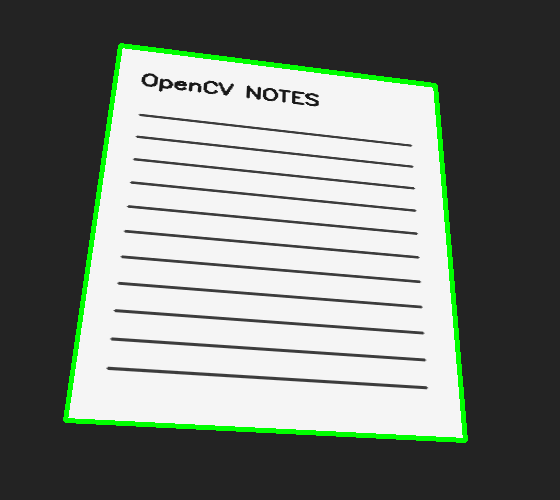

# 第16周讲义｜项目二：文档扫描与结课

[本周计划](README.md) · [完整代码](demo.py) · [练习](练习.md)

学习方法：先读直觉和小例子，再看代码；不懂时停下来运行、打印中间值。理解的标准是能预测变化并解释结果，而不是一次读完。


## 1. 扫描器是前几周知识的一次组合

拍到的纸张可能是梯形，目标是找到纸张四角，把它拉成矩形，再让文字更清晰。它并没有识别文字内容，所以不是OCR。也没有让弯曲书页变平，单个透视矩阵主要处理近似平面的纸张。

本项目假设纸张边界清晰，四角完整入镜，与背景有一定对比度，而且是图中主要的大四边形。真实场景里桌面、屏幕或装饰框也可能满足几何条件，需要检查误选。

## 2. 从亮度变化找候选四边形

灰度化后做轻度高斯滤波，减少噪声；Canny提取边缘；小核闭运算连接细小断缝；寻找轮廓并按面积从大到小检查。面积至少占图像15%，用于排除文字和小图案，但不是一条自然规律。

对轮廓做多边形近似，保留恰好4点且凸的候选。凸的直觉是四角都向外，没有一个角凹进去。本例先取最大的合格候选，所以若背景里有更大的矩形，也可能选错。结果图上的绿色边框是必要检查，不是装饰。

## 3. 四点对应为什么必须有明确顺序

透视变换需要从四个源角点对应到目标矩形四角，顺序错会让纸张扭曲、镜像或翻转。代码先计算四点中心，按相对中心的角度排序，得到绕一圈的次序，再从坐标和最小的点开始，适用于本例常规拍摄姿态。

这比独立用坐标和/差取四个极值更不容易重复选中同一点，但极端旋转时“哪一个角应成为内容的左上角”仍可能含糊。几何拉直不代表文字一定正向；真实产品可增加手动旋转或文字方向判断。

## 4. 输出宽高为什么要测两条边

斜拍时上边和下边长度不同，代码取两者像素长度中的较大值作为目标宽，高也类似。这样得到实用的扫描输出，但没有已知纸张尺寸或相机信息时，它不保证严格恢复物理长宽比，更不能直接测真实毫米尺寸。

```python
target = np.float32([[0,0], [width-1,0],
                     [width-1,height-1], [0,height-1]])
H = cv2.getPerspectiveTransform(corners, target)
warped = cv2.warpPerspective(image, H, (width,height))
```

第一句定义目标矩形，第二句求对应关系，第三句重采样生成拉正图。若纸张皱折，不同局部不再共面，单个H无法同时修正所有弯曲。

## 5. 拉正后再考虑文字可读性

先保留彩色拉正图，再对灰度图做局部二值化。这样即使黑白阈值不理想，仍有未丢失色彩和灰度层次的版本可重新处理。二值化可能擦掉浅字、淡印章或细线，因此不要把处理结果默认当作唯一可信原件。

本例合成文档内容清晰，主要用于验证几何流程。换成手机照片时，需要关注阴影、反光、纸张颜色和失焦；有些问题在图像采集时解决，远比后处理稳定。

## 6. 失败应该成为一个明确结果

找不到四边形时，程序报告success为False并说明原因，而不是悄悄拿整张图片当扫描结果。练习包括正常、纯色空白和四角裁掉的图。若困难图被错误接受，要把它标为误识别，而非看到有输出文件就说成功。

```powershell
python demo.py --input "D:/你的图片/纸张.jpg"
```

替换成自己的路径后，依次检查原图、边缘、绿框、彩色拉正图、黑白图。先定位哪一环失败，再回到相应周复习。

## 7. 结课时怎样证明自己真的会了

不看参考代码，画出两条项目流程，并能解释每个中间结果代表什么；修改输入尺寸、亮度或角度后，能预判可能坏在哪一步；看到失败能保存证据并缩小问题范围。比一次性背出函数名更重要的是：你能根据问题选工具，知道证据是什么，也知道结论在哪里失效。

未来可继续学DNN推理、深度学习检测、OCR、相机三维几何或C++工程化。当前16周建立传统视觉和实验能力，不把这些扩展方向伪装成已经学完。


## 运行后对照这些结果

输出斜拍图、边缘图、绿色四边形、拉正彩色文档和黑白文档；空白图应明确失败；裁切反例用于观察误识别或拒绝行为。

下面图片来自随课程实际运行保存的输出；重新执行程序后图片会更新。

**候选四边形**



**拉正后的文档**


更多中间结果在本周 `outputs` 文件夹；数值解释见 [metrics.json](outputs/metrics.json)。

## 查官方文档时看什么

先在官方目录找到本周主题，再看参数、返回值、输入数据类型与例子。官方链接用于核对接口；本讲义中的生活比喻、实验安排和示例代码为本课程编写。

- [OpenCV-Python 官方教程总目录](https://docs.opencv.org/4.x/d6/d00/tutorial_py_root.html)
- [OpenCV 图像处理教程目录](https://docs.opencv.org/4.12.0/d2/d96/tutorial_py_table_of_contents_imgproc.html)
