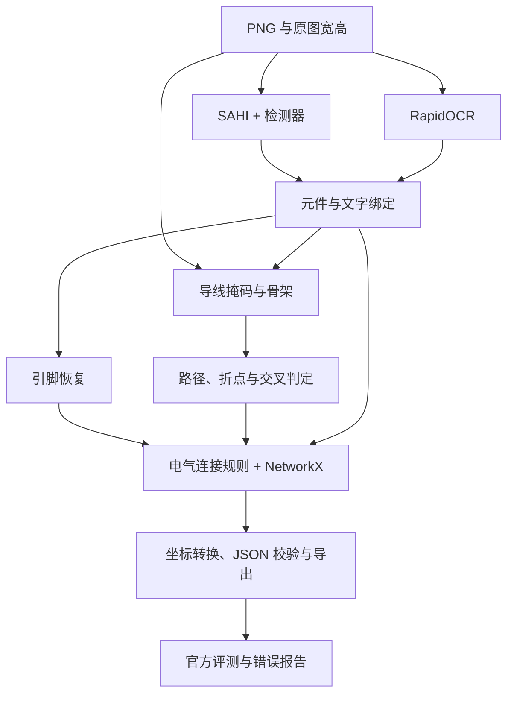

# PCB 原理图解析：五模块方案实施计划

计划日期：2026-10-11。技术主线：检测器 + SAHI + RapidOCR + 导线骨架分析 + NetworkX。

目标：PNG 原理图 → 元件、引脚、网络 → 赛事规定的 JSON，并交付可运行程序和 Word 技术报告。本文是执行计划，尚未安装模块、运行权重或取得比赛 F1。

按单人每天 4–6 小时安排，预计 135 个开发工时；训练等待和批量评测另计墙钟时间。先完成 CPU 可运行基线，GPU 用于有数据支持的可选微调。前两天交付可评测入口，随后逐步完善识别能力。

官网目前显示报名截止 2026-10-16、作品提交截止 2026-11-07；具体截止时刻需以正式通知为准。内部安排 11/02 冻结功能、11/05 首次完整提交、11/06 复核、11/07 应急缓冲。[官方赛程](https://cpipc.acge.org.cn/cw/hp/2c9080158ee9c272018f229208b610a6)

## 1. 技术选型及必须补齐的代码

| 部分 | 首版选择 | 直接复用什么 | 本项目实现什么 |
|---|---|---|---|
| 检测器 | [Ultralytics](https://github.com/ultralytics/ultralytics)；优先试验已有电路权重 | 模型加载、推理、训练接口 | 官方类别映射、框定义校准、遗漏类别处理、检测适配器 |
| 大图切片 | [SAHI](https://github.com/obss/sahi) | 切片检测、坐标回映射和合并 | 原图/切片对照、去重配置、大 IC 跨切片处理 |
| OCR | [RapidOCR](https://github.com/RapidAI/RapidOCR) + ONNX Runtime 后端 | 文字检测、识别、文本置信度 | 位号/型号/值绑定，引脚编号/名称绑定，小字局部重识别 |
| 导线骨架分析 | OpenCV + [scikit-image](https://github.com/scikit-image/scikit-image) + [Skan](https://github.com/jni/skan) | 掩码处理、骨架化、路径追踪 | 器件/文字干扰抑制、交叉语义、折点分段、引脚接触 |
| 图计算 | [NetworkX](https://networkx.org/documentation/stable/reference/algorithms/generated/networkx.algorithms.components.connected_components.html) | 图存储、遍历、连通分量 | 物理连接规则、同名标签合并、线段归网、赛事超图表达 |
| 引脚恢复 | 自主模块 + 赛事允许的元件库 | 库中的符号及引脚先验，格式合适时使用解析库 | 方向/镜像匹配、number、pinname、tip 原图坐标 |
| 导出与评测 | 自主适配器 + 官方评测器 | 官方匹配与评分实现 | JSON、引用/坐标校验、逐例报告、错误可视化 |

检测器优先验证 [HR-DONK 的候选电路权重](https://github.com/HR-DONK/circuit-recognition)，只取需要的检测资源或封装。仓库 README 描述 10 类和 `circuit_yolov8n_v3.pt`，其主要场景包含教材图、手绘和照片；类别及权重能否满足密集 PCB 图，需要实际测量。连接器、信号标签等未覆盖对象要列入缺口表，不能靠把不相干类别改名解决。

复现时固定 commit、依赖版本、模型哈希与来源，并登记代码、权重、数据各自的许可。首版不接入 SAM、Netlistify 或多模态纠错；先用五模块的真实错误报告判断后续实验是否必要。

## 2. 流水线和坐标约定



检测与 OCR 是两条分支。SAHI 默认只用于检测；OCR 的局部裁剪、放大和去重由自己的适配器实现。导线初始候选可直接从原图提取，之后利用元件与文本区域筛选。NetworkX 必须收到引脚和已经判定电气意义的导线结构。

内部统一采用原图像素坐标：左上原点，x 向右、y 向下；不在模块之间混用归一化坐标。每个切片/裁剪保存偏移、缩放、旋转及逆变换，输出立即回到原图。Skan 的 row/column 在适配层转成 x/y。

正式导出时才转换到赛题的左下原点、y 向上。用 Golden 确定 H 或 H−1 的像素约定及 bbox 边界顺序；未确认前把此项标为待核验。所有中间图使用同一坐标声明，避免重复翻转。

## 3. 分阶段输入、输出和指标

下表所有文件都是计划实现的中间产物。接口指标从第一版执行，质量指标在固定开发集上测量。表中的 F1 是建议目标，尚无实测成绩。

| 阶段 | 输入与输入检查 | 输出 | 验收指标 |
|---|---|---|---|
| S0 规格和数据 | PDF、Golden、官方评测器、元件库、正式环境；每项记录版本或缺失 | `requirements.md`、数据清单、类别表、JSON 校验规格 | 已知规则映射率 100%；关键歧义都有状态；合法 PNG/标注配对读取率 100% |
| S1 可评测基线 | 一个中等、一个困难例；模块能导入，权重路径明确 | 原始检测/OCR、初步 JSON、逐例评测与时间日志 | 两例输入→导出→校验→评测可运行；失败有日志；无虚构成绩 |
| S2 检测器 + SAHI | PNG、类别映射、相同权重与固定配置 | `detections.json`、`tiles.json`、检测叠加图 | 坐标往返误差 ≤1 px，框格式合格率 100%；记录每类召回、接缝重复、相邻器件误合并与耗时 |
| S3 OCR + 元件绑定 | 原图/局部图、检测框、完整变换 | `ocr.json`、`components_internal.json`、绑定叠加图 | 原文和来源保留率 100%，已导出位号重复 key 为 0；端到端 ComponentF1 目标 ≥0.80 |
| S4 引脚恢复 | 元件、OCR、局部图、方向候选及允许的元件库 | `pins_internal.json`、引脚局部叠加图 | 无效元件引用 0、同器件编号冲突 0；端到端 PinF1 目标 ≥0.70；单独报告 tip 的误差分布 |
| S5 导线骨架 | 原图、元件 body/文本区域、引脚附近保护区 | `wire_mask.png`、`skeleton.png`、`segments.json`、`junctions.json` | 8 类几何用例通过；每条导出候选段恰有两个端点；折点和交叉判断可追溯 |
| S6 NetworkX | 同坐标的引脚、线段、有效连接点、标签及合并规则 | `graph.json`、`nets_internal.json`、逐网叠加图 | 无效引脚引用 0；每条已导出线段能追溯来源和归网；H F1 ≥0.65、L F1 ≥0.60 为首轮目标 |
| S7 联调和优化 | 固定划分、全预测流水线、错误分类与基线 | 消融对照、最佳配置、回退版本 | 同一开发集记录四项 F1、全案例加权分、失败数和耗时；每项改动收益有证据 |
| S8 提交复现 | 冻结代码/权重、正式入口、保留集 | 提交包、冷启动日志、Word 报告 | 完成率/JSON 合格率 100%；内部目标 50 例冷启动总耗时 ≤100 分钟，官方要求 <120 分钟 |

正式 F1 必须来自全预测结果；检测 mAP、OCR 字符准确率、wire mask IoU 和原始线段匹配只作诊断。NetLineF1 依赖先匹配网络，不能把“所有线段位置很准”当作正式线段得分。

前两天允许 pins/nets 有明确遗漏，以真实低分建立基线；结构合法仅说明接口跑通。真实标注仅用于训练、诊断或评测，不能填入推理输出。

## 4. 各模块的具体开发任务

### S0–S1：先把调试入口搭好

1. 清点正式数据、Golden、元件库、评测器、Q&A、平台硬件和入口；建立“已有/缺失/待核验”表。
2. 固定 schema：`components`、`pins`、`nets`；特别核对组件字段 `Name` 的大小写和实际评测器口径。
3. 选一个中等例和一个困难例，保存输入哈希和离线标注来源；不把上游样例的视觉效果当比赛成绩。
4. 建立单图、批量、评测、叠加图四个入口；检测/OCR 能真实运行时保存实际输出，其余模块先返回明确的空预测或失败状态。
5. 实现分阶段计时、错误日志、中间结果落盘和断点重跑。模型在一次批量进程中加载一次，避免每个切片重载。
6. 官方评测器缺失时，仅建立明确标为 proxy 的校验/评测；没有 Golden 时使用人工复核小例检查链路，官方成绩保持“未验证”。

### S2：检测器 + SAHI

1. 从训练集/获准分析的公开标注统计官方 type；核验候选权重的 `class_id → class_name`，输出类别覆盖差异表。
2. 实现独立 `DetectorAdapter`：输出 uid、类别、原图 bbox、confidence、模型版本和来源切片。
3. 先跑整图 E00；然后固定相同权重、输入集、置信度，对照 SAHI。大 IC 或跨切片器件用整图候选补充，再统一去重。
4. 起始参数：切片 1024×1024、重叠比例 0.125、confidence 0.25。先只比较切片边长 768/1024/1280，再对选出的边长比较重叠 0.125/0.25，不做无边界组合搜索。
5. 对同类相邻器件分别检查 NMS/NMM 的误合并；合并阈值按实际选用的 IoU/IoS 口径记录，不能只写一个含义不明的“0.5”。
6. 检测框与 Golden bbox 定义不一致时增加独立框校准，分别保存 body bbox、预测 bbox、官方输出 bbox。修复该差异后再比较检测精度。
7. 类别缺失或定位明显不足时，只在训练数据与 GPU 可用后安排一次小型微调。先转换训练标注、验证 20 个框和类别，再短训确认标签和损失正常；保留训练/验证最佳权重，不能用最终保留集选模型。

调试时必看：整图结果、全部切片框、合并后框、漏检/误检/重复清单，以及一对“相邻器件被合并”的失败局部。SAHI 不能修复模型没有学过的类别。

### S3：RapidOCR + 文字绑定

1. 独立使用所选 RapidOCR 接口，固定返回格式；旧 `rapidocr-onnxruntime` 封装需单独转换，不能默认和 `rapidocr` 当前结果对象一致。
2. 全图识别一次，再对 IC/连接器/密集小字区域补做局部识别；局部放大先试 2×，再根据关键字段结果调整。缓存相同区域，减少重复 OCR。
3. 保存 `text_raw`、四点框、confidence、region_id、transform_id；任何清洗结果另存 `text_candidate`，不覆盖原文。
4. 将候选用途分成位号、IC Name、无源器件 value、pin number、pinname、net label。按距离、方向、器件类别和唯一性绑定。
5. 首版采用确定规则：元件附近的位号候选先绑定，再用剩余文本绑定型号/值；多候选冲突时保留排序和原因，局部重识别后重新判断。
6. 单独记录常见混淆如 0/O、1/I、5/S，但按局部证据决定修补。保留大小写、空格和单位；10k 与 10K 不能全局归一化。
7. 重复位号后缀按官方转换器/Golden 规则实现；不能默认按页面从左到右的顺序生成。

诊断指标：位号 exact-match、IC Name exact-match、R/C value exact-match、绑定串配数、小字漏识别率；分母与匹配条件明确记录。验收仍用端到端 ComponentF1。

### S4：引脚恢复——预留最多的连续开发时间

1. 按器件优先级完成：电阻/电容等简单器件 → 连接器 → 多引脚 IC → 特殊标签及电源。每天在真实图上保存至少一个 IC、一个连接器和一个无源器件的局部结果。
2. 在每个元件四周提取短线/端点候选，找朝器件外侧的 tip；tip 是与外部导线连接的位置，不是器件 body 边界。
3. 建立器件各边的候选序列，结合附近 number/name 文本和方向匹配；编号不能直接由“扫描到的第几个端点”代替。
4. 使用赛事允许的元件库核验编号、名称、符号单元及方向。库格式确认后再选解析器；库坐标必须经过缩放、旋转/镜像和平移与图像对齐。
5. 图像符号和库符号不一致或型号不确定时，保留图像证据路径；不能仅凭型号把库中所有引脚强行投影到图上。
6. 多编号引脚拆分、无编号引脚自动编号、空名称按官方规则处理；保留冲突原因和失败样例。
7. 同时检查 pin-wire 接触和 pin-pin 直接接触。引脚接触距离为待调参数，与官方 5 px 评分容差是不同概念。

错误分解：所属器件错误、编号错误、名称错误、tip 位置错误、引脚漏检/多检。使用真实元件输入的诊断和使用预测元件的正式结果分开记录，明确误差来自上游还是引脚模块。

### S5：导线掩码、骨架与几何结构

1. 彩色图先统计导线颜色并提取候选；灰度图采用二值化、方向和线宽证据。颜色阈值写入配置，不假定全部样本使用同一颜色。
2. 元件 body、文字区域用于抑制干扰，同时保护引脚及标签的接入区域。不能直接把整个检测框和文字框涂白，否则会断掉真实导线。
3. 使用 scikit-image 骨架化，再用 Skan 追踪路径。保留完整像素路径、几何候选及原始图区域，便于解释伪分支。
4. 提取端点、折点、T 分支和交叉候选；用局部原图中的连接点、间隙或跨线形状判定连接意义。
5. 无连接交叉分成独立通道，例如水平与垂直路径分别贯通；不能把四个方向全部并网，也不能简单删除中心像素导致两条线都断开。
6. 修复断线时要求方向、间距及图像路径证据，记录每次补连；纯距离接近只生成待核候选。
7. 折线按拐点拆成两点线段，并核对 Golden 的分段方式。骨架每个像素不是一条赛事 edge；多折点分支也不能直接只保留首尾。

8 类回归小例：直线、L 折线、T 分支、带连接点十字、无连接交叉、局部断线、pin 直接相接、文字/器件边框干扰。它们用于验证电气处理，不能代替真实图的质量评测。

### S6：NetworkX + 电气规则 + 正式导出

1. 建物理图：节点为 pin、导线端点、折点和有效连接点；边保存 segment_id、实际像素路径或接触证据。无连接交叉的通道保持分离。
2. 依据已校验的 pin 接触规则把引脚接到图上，求物理连通分量；保留孤立引脚和未归网候选供诊断。
3. 加入同名标签的逻辑连接，并按赛题区别普通标签与 VCC/GND；标签自身引脚按正式约定纳入网络。标签间未画线时不生成跨图长线。
4. 为每个 net 建立完整 pin set 和 segment_id 集合。用内部 uid 组织数据，正式导出才转成 `U1.A5` 等引用，减少位号修改引起的引用断裂。
5. 输出 `pins[designator][pin_<number>]`、`hyperGraph` 和两点 `edges`；保留官方要求的零长度线段、直接接触和飞线表示。
6. 校验每个引用、坐标、bbox、字段大小写及 edge 格式；正式 JSON 不带内部 confidence、evidence 等额外字段。

人工检查顺序：选一个错误 net → 画出预测和真实 pin set → 回溯连接证据 → 确定是引脚错误、断线、交叉误并还是标签误并。优先修复让多张图整网合并错误的问题。

## 5. 日程与具体里程碑

| 日期 | 阶段 | 工时 | 必须完成的具体成果 |
|---|---|---:|---|
| 10/11 | S0 | 4 h | 正式材料清单、schema/坐标问题表、固定两例、项目接口和环境选择 |
| 10/12 | S1 | 6 h | 检测/OCR 至少真实跑通所选例；PNG→合法 JSON→评测/明确 proxy 跑通，保存 E00 |
| 10/13–16 | S2 | 20 h | 检测类别审计、SAHI 接入、原图回映射、原图/切片对照；16 日确定检测配置和类别补齐方案 |
| 10/17–19 | S3 | 15 h | OCR 局部重识别、位号/Name/value 绑定、组件输出与评分；19 日给出组件错误分布 |
| 10/20–23 | S4 | 22 h | 引脚 tip、编号、名称及方向；23 日提交逐器件错误分解和 PinF1 |
| 10/24–26 | S5 | 15 h | 掩码、骨架、交叉/折点处理；26 日通过 8 类小例并完成真实图叠加 |
| 10/27–29 | S6 | 15 h | 物理图、标签连接、超图/线段归网；29 日输出完整 components/pins/nets 和四项 F1 |
| 10/30–11/02 | S7 | 20 h | 根据最大失分完成 2–3 个受控实验，测完整开发集；2 日冻结最佳已验证配置 |
| 11/03–06 | S8 | 18 h | 冷启动整批、环境复现、报告和提交包；5 日首次完整提交，6 日复核 |
| 11/07 | 缓冲 | 预留 | 仅处理必要的文件、入口、依赖和上传问题，以正式截止时刻为准 |

总计 135 h。每天最后预留约 30 分钟更新：当天配置、失败样例、逐例指标和次日任务。训练排队或下载困难时，继续做接口、标注核验、引脚和几何回归，避免整条主线停顿。

功能日期是推进节点，质量门槛是待验证目标。某项 F1 未达标时保留最好版本并记录缺口，继续完成全链路；到冻结日依据完整开发集选版本，不能为了凑目标延迟打包。

## 6. 每个模块的数据契约

所有中间文件带 `schema_version`、`case_id`、`image_width/height`、`coordinate_frame`、输入哈希和配置/权重版本。下列字段是内部接口，不能直接当作官方 JSON。

| 对象 | 最少字段 | 下游依赖 |
|---|---|---|
| Detection | uid、class_id/name、bbox、confidence、source_tile_ids | 文字绑定、body 区域、引脚局部图 |
| OCRText | uid、text_raw、polygon、confidence、region_id、transform_id | 位号、值、型号、引脚及标签 |
| Component | uid、designator、official_type、Name/value、body_bbox、official_bbox、text_ids | pins 与导出 |
| Pin | uid、component_uid、number、pinname、tip、orientation、evidence_ids | 电气图与导出 |
| Segment | uid、p1/p2、path_id、junction_ids、source_evidence | 连接图、归网与线段导出 |
| Junction | uid、point、kind、port_groups、evidence_ids | 交叉分离或并网 |
| Net | uid、pin_uids、segment_uids、physical_group_ids、label_merge_evidence | hyperGraph 和 edges |

未知或冲突项在内部记录候选及失败原因，正式输出如何表示缺失按赛事 schema 处理。中间层保留证据，便于从一个错误 JSON 字段回到原图局部。

## 7. 数据、评测与实验纪律

数据充足时，快速集选 6 例（2 中等 + 4 困难），固定开发集建议 20 例（8 + 12），最后保留 10 个独立源工程例（4 + 6）。快速集属于开发集；训练、开发、保留集按源工程隔离，同源导出、切片和增强不能跨集合。数据不足时报告实际例数，不复制图片凑数量。

每次修改先跑快速集，发现失败就定位修复；通过后运行固定开发集。记录所有指定案例，未完成或失败按正式口径计入分母。

赛事准确度的四项加权部分为：

```text
S_i = 100 × (0.30 × ComponentF1 + 0.25 × PinF1
             + 0.35 × NetHypergraphF1 + 0.10 × NetLineF1)
ScoreAccuracy = Σ已完成案例 S_i / 全部指定案例数
```

首轮建议 C/P/H/L = 0.80/0.70/0.65/0.60，对应 70.25；后续建议 0.90/0.85/0.80/0.80，对应 84.25。这只是准确度部分的计划值，不是完整最终分或获奖标准。Token 和数据附加分按正式规则另行统计；只用本地 Token 消耗无法确定赛事排名分。

| 实验 | 单一主要变化 | 比较输出 |
|---|---|---|
| E00 | 整图检测 + OCR + 初始结构输出 | 第一个可复现基线，所有缺失如实记录 |
| E01 | 接 SAHI，保持同权重和文本规则 | 小目标/接缝错误、四项 F1 与耗时 |
| E02 | 局部 OCR 与字段绑定 | 文本精确匹配、ComponentF1、下游变化 |
| E03 | 完善引脚恢复 | 编号/名称/tip 错误和 PinF1、H F1 |
| E04 | 交叉语义及标签规则逐项接入 | 错并/漏并网、H F1、匹配网内 L F1 |
| E05 | 一个由错误分布支持的改进 | 四项 F1 净收益、退化案例、运行预算 |

基于 `ΔS=100×(0.30ΔC+0.25ΔP+0.35ΔH+0.10ΔL)` 判断收益，同时检查困难案例和全部运行时间。配置、提交版本、依赖、逐例结果必须保存；不把多个无关改动合成一次实验后分别宣称贡献。

## 8. 调试方法：让修改只重跑必要部分

每个 stage 提供独立入口，读取固定中间文件并输出自己的产物。缓存键使用输入内容、配置、模型/代码版本；上游数据变化会使下游缓存失效。用于加速的缓存只存预测结果，不能读取评测答案。

| 症状 | 首先检查 | 调整位置 |
|---|---|---|
| 小电阻/电容漏检 | 整图与切片原始框、类别覆盖 | SAHI 参数；必要时检测训练 |
| 两个相邻器件变成一个 | 合并前后框和匹配度量 | SAHI 合并策略/阈值 |
| R1 被绑到 R2 的值 | OCR 原文、候选用途、距离/方向 | text_binding |
| IC 名称可见但引脚缺失 | pin 小字是否识别、短线候选 | OCR 局部尺度与 pins |
| 引脚点整体偏移 | 裁剪缩放、tip 定义、库变换 | transforms / pins |
| 大面积网络合并 | 第一次造成合并的连接证据 | 交叉、文字粘连、标签规则 |
| 网络漏连 | 断线、pin 接入和标签映射 | wires / contact / label_merge |
| NetLineF1 低但线位置看似正确 | 匹配 net、归网和分段 | nets / segment_split / exporter |
| 所有 y 坐标颠倒 | 输出转换次数和 H/H−1 | exporter |

必须生成四层调试图：检测/OCR 层、元件/引脚层、骨架/交叉层、逐网层。逐网层能只显示一个 net、其 pin 引用和每条线段的证据，避免整图叠加过密。

## 9. 计划目录与接口

计划项目根目录：`C:/Users/Pc/Desktop/vision/pcb_parser_competition`。本轮仅生成本文，以下代码和目录尚未创建。

```text
pcb_parser_competition/
  docs/requirements.md, open_questions.md, repo_audit.md
  configs/baseline.yaml, best.yaml
  schemas/submission.schema.json
  data/manifest.jsonl, splits/
  src/pcb_parser/
    contracts.py, transforms.py
    adapters/detector.py, sliced_detector.py, ocr.py
    text_binding.py, components.py
    symbol_library.py, pins.py
    wire_mask.py, skeleton.py, junctions.py, segment_split.py
    contact.py, label_merge.py, nets.py
    exporter.py, validator.py, evaluator.py
    cache.py, runtime.py, cli.py, visualize.py
  weights/manifest.json
  artifacts/<case_id>/<stage>/
  runs/<experiment_id>/config.yaml, metrics.csv, failures.jsonl
  submission/<case_id>/<case_id>.json
```

待实现命令约定，不是现有可执行程序：

```text
python -m pcb_parser.cli infer --image <PNG> --output <JSON> --config <YAML>
python -m pcb_parser.cli batch --manifest <JSONL> --output-dir <目录> --config <YAML>
python -m pcb_parser.cli stage --name <阶段> --case-id <ID> --config <YAML>
python -m pcb_parser.cli evaluate --pred-dir <目录> --gt-dir <目录> --report-dir <目录>
python -m pcb_parser.cli render --case-id <ID> --layer <层名> --output <PNG>
```

平台入口不同则增加薄适配层。依赖锁定以正式 Python/PyTorch 和运行环境为准；需要其他框架组合时按赛题准备可运行 Docker，并核验 ONNX Runtime 等依赖实际兼容性。

## 10. 运行预算、降级和交付

50 例总预算：官方 <120 分钟，内部目标 ≤100 分钟（含加载与全部开销）。第一版基础流水线平均单例目标 ≤90 秒；最终以冷启动整批验证为准，并记录每模块时间、单例 P50/P95、失败和超时数。

| 触发条件 | 执行决定 |
|---|---|
| 10/12 候选整仓库仍不能跑 | 独立接入 Ultralytics/RapidOCR，保持相同内部契约；不继续为整仓库外围功能花时间 |
| 权重类别缺失 | 记录不可识别类别；用训练数据补齐或图像/文字规则候选，严格评估，不以改名代替识别 |
| 没有 GPU | 保留 CPU 五模块推理，训练单列为可选；不承诺未测过的速度 |
| 10/23 引脚效果不足 | 优先位号、IC 编号、tip；依据错误分布压缩可选微调，保留导线/网络时间 |
| 骨架受文字或交叉干扰严重 | 先修掩码和交叉通道；错误证实几何路线不足时才研究学习型导线模型 |
| 10/29 全链路仍失败 | 停止新增算法，先修坐标、引用、图连接与导出 |
| 11/02 指标未达建议值 | 冻结已验证最佳版本，准确报告结果，继续提交准备 |
| 冷启动整批超预算 | 优先减少重复 OCR、冗余切片和无效重试；对同一集复核质量变化 |

最终交付：运行程序与正式入口、权重来源/哈希、固定依赖及必要镜像、最佳配置、全部指定案例 JSON、逐例四项 F1 与失败分析、冷启动时间记录、Word 技术报告。数据贡献按正式《数据提交说明》另行安排，不挤占主线提交。

下一步可执行的最小任务：清点正式输入资料 → 确定两例 → 建好接口/校验/评测 → 真实跑检测和 OCR → 保存 E00。完成后才有依据调整本计划的阈值、工时和模型选择。

赛题依据：用户上传的 0803Rev1 PDF；开源接口与赛程依据为本文所链接的官方仓库、文档和官网。已检索过源码不等于已运行；文中的质量和时间均需后续实测。
