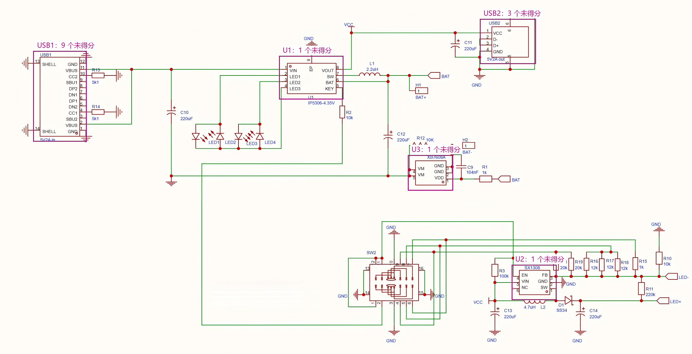
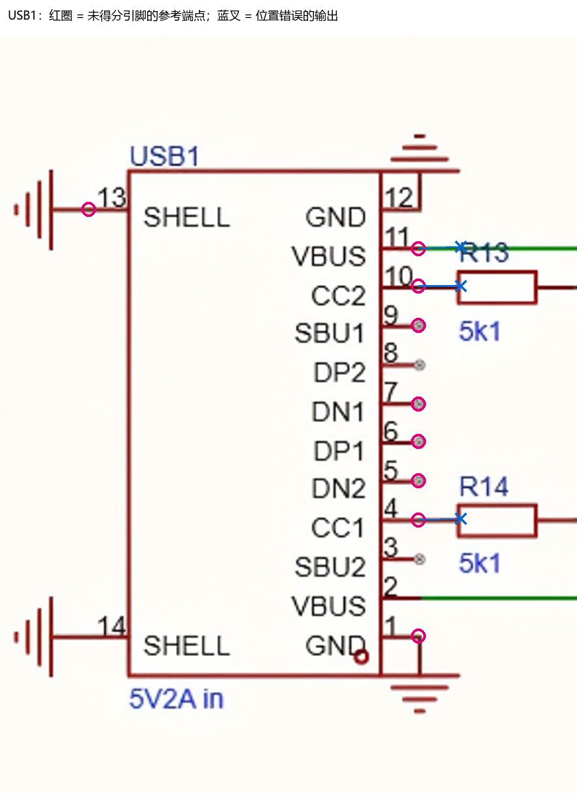
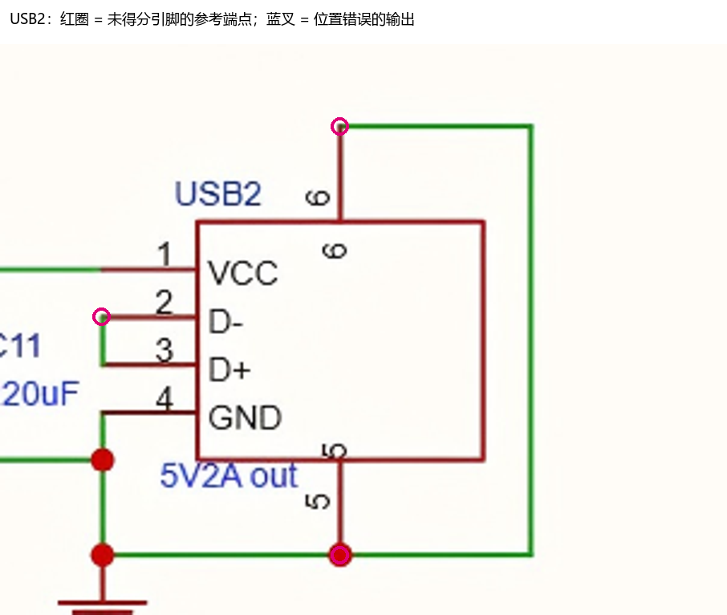
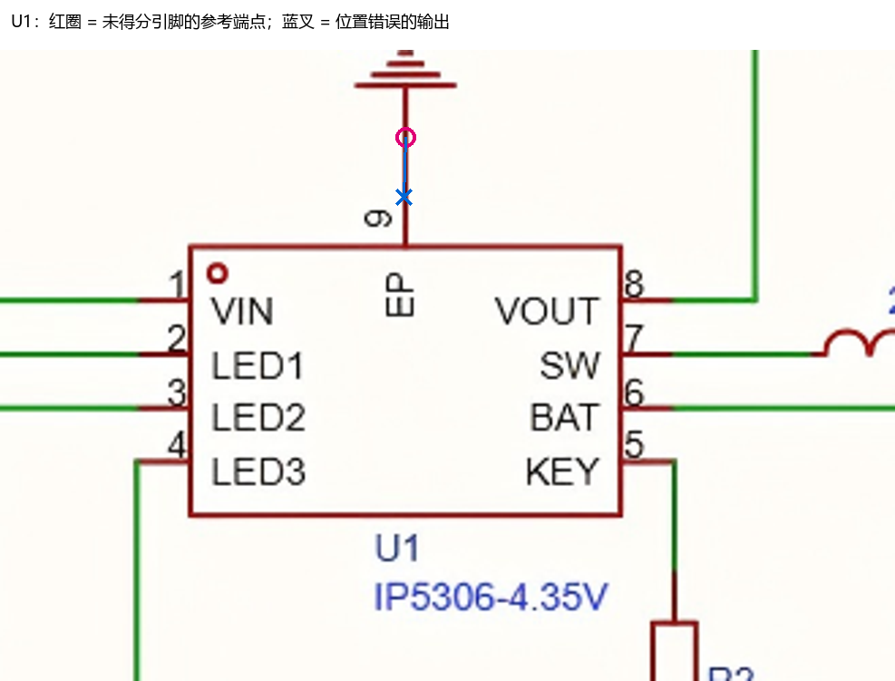
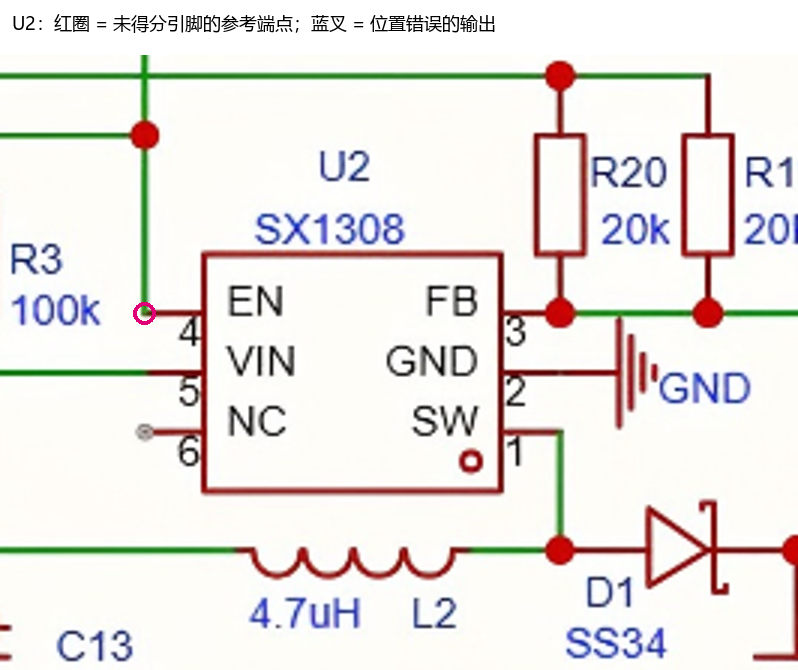
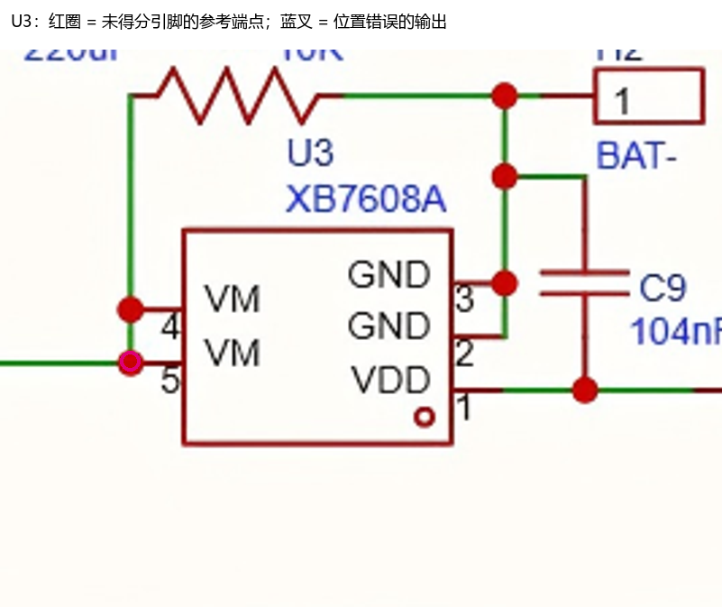

# 第 1 页单独排查

当前引脚评分：TP=25、FP=10、FN=15，PinF1=66.67%。共 40 个参考引脚，25 个得分、15 个未得分；错误编号/坐标可能同时产生 FP 和 FN。

本次只复用已有结果，未修改正式代码、未新增推理。

## 问题分布

## 15 个未得分引脚

| 引脚 | 已核实的问题 | 对应处理方向 |
|---|---|---|
| U1.9 EP | 原候选在本体顶部附近；顶部引线比左右引线长，却统一取整器件中位数 18 px，最终离参考端点 22.01 px | 按侧面区分引线长度，结合端点和地符号连接处；不能整器件统一长度 |
| U2.4 EN | 缺可用主候选；最近的是相邻 VIN 行，不能复用 | 对可见引线做局部候选补检 |
| U3.5 VM | 有候选且 VM 已读出，但库内 VM 同时对应 4、5，名称反查把此处补成 4 | 一名多号不能直接取首项；读局部数字并做一对一分配 |
| USB1.1 GND | 尖端附近候选归给了地符号 UNRESOLVED_DET_0057；另一个 USB1 的 GND 候选也缺编号 | 联合器件边、引线方向和文字重审归属及编号 |
| USB1.4 CC1 | 编号、名称正确，后处理把正确附近的点向右推过头 | 修正端点测量及采信条件 |
| USB1.5 DN2 | 原图有未接线短引脚，缺可用几何候选 | 对未接线短引脚补检 |
| USB1.6 DP1 | 同上 | 同上 |
| USB1.7 DN1 | 名称正确，号码为空；条带 OCR 读成 2/27，随后报编号已占用 | 按引脚方向和间距裁剪，保留文字位置并重排候选读数 |
| USB1.9 SBU1 | 名称正确；条带读数含 2、9，但当前选中冲突读数，报编号已占用，未补回 9 | 窄化行窗口，按空间位置选择数字，不能直接放开去重 |
| USB1.10 CC2 | 字段正确，端点被推过头 | 同 CC1 |
| USB1.11 VBUS | 字段正确；自身长度读到 8 px 被最小 12 px 门槛排除，再套用其他两脚读出的 30 px | 允许有证据支持的短引脚，拒绝错误跨引脚统一 |
| USB1.13 SHELL | USB1 与地符号的归属代价仅差约 0.92 px，小于 2 px 模糊门槛，被置为 ambiguous_owner | 用引线方向、外壳布局和文字补充归属证据 |
| USB2.6（名称 6） | 有尖端候选；编号 6 落在靠本体的另一候选上，尖端候选却读到 1；原图竖排 6 在既有裁剪 OCR 的 90° 视图中可读 | 方向感知的数字裁剪及同引脚候选合并，不能只释放号码 |
| USB2.5（名称 5） | 编号已有 5，名称为空；数字名称补全只照顾本轮新加编号且整器件无名称的情况，此器件含 VCC/D+/GND，被整器件跳过 | 按单脚证据处理混合命名，不能给所有缺名脚复制编号 |
| USB2.2 D− | 主候选有 D−，辅助候选占了编号 2；主候选随后被 number_already_used 拦下 | 把辅助候选的编号证据合并给同一物理引脚 |

### 坐标问题的直接证据

| 引脚 | 后处理前误差 | 正式结果误差 |
|---|---:|---:|
| USB1.4 CC1 | 5.96 px | 21.97 px |
| USB1.10 CC2 | 7.27 px | 21.97 px |
| USB1.11 VBUS | 6.67 px | 21.98 px |
| U1.9 EP | 29.19 px | 22.01 px |

USB1 使用的右边框 x=268.967。CC1/CC2 测得 30 px，VBUS 测得 8 px 被过滤，于是三脚均采用中位数 30 px，落到 x=298.967；参考端点 x=277。需检查的是颜色扫描采到哪里、短引线门槛和统一策略。

U1 左右引脚测量集中在 17–19 px，顶部 EP 单独测到 59 px，最后仍被整器件中位数压到 18 px。原图明确显示 EP 与侧面引脚长度不同；59 px 的单独读数本身也不能直接采信，需检查地符号连接位置。

**不能全局关闭 pin_lead_snap。** 在保留相同器件框的诊断副本上，关闭后第 1 页变为 TP=24、FP=11、FN=16，PinF1=64.00%，低于现有 66.67%；第 11 页不变。回放只说明缺陷位置，不代表已验证一个可部署的修复方案。

## 局部图

### USB1

### USB2

### U1

### U2

### U3

## 建议优先级

先修 USB1 的三个坐标偏移和 USB2.D− 的主/辅助候选信息分裂，再验证其余文字绑定、归属、VM 一名多号与三个真正缺少候选的问题。这里是问题定位，没有把参考标注写进预测，也尚未验证可部署修复的提分。
